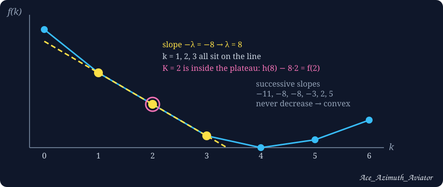
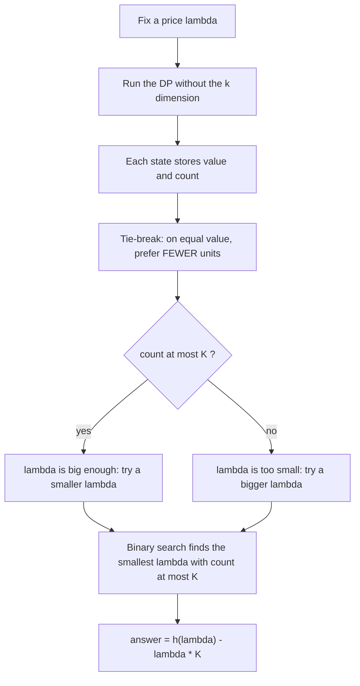

# The Aliens Trick: Put a Price on K



| | |
|---|---|
| **Also known as** | Lagrangian relaxation, WQS binary search, "lambda optimization" |
| **Solves** | "Use exactly K things" problems where K is too large to be a DP dimension |
| **Core requirement** | The optimal value as a function of K, `f(K)`, is **convex** (min) or **concave** (max) |
| **Typical cost** | One DP without the K dimension, repeated `log(range)` times |
| **Difficulty** | Advanced (the idea is short; the details are where Wrong Answers live) |

> [!NOTE]
> Everything on this page was tested: each code block passes its problem's samples and agrees with a brute force on thousands of random small cases. The convexity claims for CF 868F and CF 125E were also checked by brute force on small inputs.

---

## Table of Contents

- [1. The problem shape](#1-the-problem-shape)
- [2. The idea: put a price on K](#2-the-idea-put-a-price-on-k)
- [3. Why it works: tangent lines](#3-why-it-works-tangent-lines)
- [4. The requirement: is f(K) convex?](#4-the-requirement-is-fk-convex)
- [5. The algorithm](#5-the-algorithm)
- [6. The template](#6-the-template)
- [7. Worked example 1: CF 958E2 Guard Duty](#7-worked-example-1-cf-958-e2-guard-duty-medium)
- [8. Worked example 2: CF 321E Ciel and Gondolas](#8-worked-example-2-cf-321-e-ciel-and-gondolas)
- [9. Worked example 3: CF 739E Gosha is hunting (two budgets)](#9-worked-example-3-cf-739-e-gosha-is-hunting-two-budgets)
- [10. Pitfalls that cause Wrong Answer](#10-pitfalls-that-cause-wrong-answer)
- [11. Aliens or not? Problems that get misfiled](#11-aliens-or-not-problems-that-get-misfiled)
- [12. Practice problems](#12-practice-problems)
- [13. Checklist](#13-checklist)
- [14. Related](#14-related)

---

## 1. The problem shape

You are asked to optimize something while using **exactly K** of some resource:

- split an array into exactly K segments,
- pick exactly K non-overlapping intervals,
- build a spanning tree with exactly K edges of a special kind.

The obvious DP carries K as a dimension: `dp[i][k]`. When `n` and `K` are both large (say `n = 4000`, `K = 800`, or `n = 5·10^5`, `K = 5000`), that table is too big or too slow.

The Aliens Trick removes the `k` dimension. The price is a binary search around a DP that is one dimension shorter.

---

## 2. The idea: put a price on K

Stop forcing exactly K. Instead, **charge λ for every unit used** and let the DP choose freely.

For a **minimization** problem, define

```
h(λ) = min over all solutions of ( cost + λ · count )
```

- If λ is large, units are expensive and the optimal solution uses **few** of them.
- If λ is small or negative, units are cheap (a rebate) and the optimal solution uses **many**.

So the optimal `count` moves monotonically with λ. Search for the λ at which it equals K, and read the answer back with

```
f(K) = h(λ) − λ · K
```

> [!TIP]
> Convention used throughout this article: **λ is the price per unit; a bigger price means fewer units.** For maximization problems the penalty is subtracted instead: `reward − λ · count`. The direction is the same.

---

## 3. Why it works: tangent lines

Let `f(k)` be the best cost using exactly `k` units. Then

```
h(λ) = min over k of ( f(k) + λk )
```

Geometrically, `f(k) + λk` is the height at which a line of slope `−λ` touches the graph of `f` from below. Choosing λ means choosing a slope; `h(λ)` is where that line is tangent.



If `f` is convex, every point `(K, f(K))` has some supporting line through it. For that line's slope the penalized optimum passes through `k = K`, and the answer is recovered by sliding back along the line:

```
f(K) = h(λ) − λK
```

**Proof sketch.** For every λ and every K, `h(λ) ≤ f(K) + λK`, so `h(λ) − λK ≤ f(K)` always. Convexity guarantees a λ where equality holds, namely the slope of a supporting line at `K`. So `f(K) = max over λ of ( h(λ) − λK )`.

This also explains the **plateau**: when several consecutive points lie on one supporting line (the figure shows `k = 1, 2, 3`), the penalized DP may report `count = 1` or `count = 3`, but the formula still returns the right `f(2)` because the value on the line is the same. The formula uses **K**, never the count the DP happened to return.

---

## 4. The requirement: is f(K) convex?

This is the one condition that decides everything. In practice, ask these in order.

1. **Is there a known structure?**
   - *Monge / quadrangle inequality* on a partition cost `c(l, r)`: for `a ≤ b ≤ c ≤ d`, `c(a,c) + c(b,d) ≤ c(a,d) + c(b,c)`. Then `f(k)` is convex in the number of segments.
   - *Matroid or min-cost-flow structure*: costs of the form "best set of exactly k" over a matroid, or flow value as a function of flow amount, are convex.
   - *Exchange argument*: moving from `k` to `k+1` units never gets cheaper per unit than the step before it.

2. **Can you brute-force it?** Write a slow DP for small `n`, print `f(1), f(2), ...`, and check that the differences never decrease. This takes minutes and catches the mistake of forcing the trick onto a non-convex problem.

3. **Does the unconstrained trick give a sensible answer?** If the penalized DP on random inputs returns counts that jump over K for no reason, `f` has a dent.

> [!WARNING]
> Aliens is **not** a general tool for every "exactly K" problem. If `f(K)` is not convex, the binary search can converge to a λ whose answer is simply wrong, with no visible symptom on small samples.

---

## 5. The algorithm



Details of each step:

1. **DP with a penalty.** Make the transition cost `cost + λ` for each unit. Each DP state stores a pair `(value, count)`.
2. **Tie-breaking.** Compare pairs lexicographically: smaller value first, then **smaller count**. Be consistent everywhere in the DP.
3. **Binary search.** `count(λ)` is non-increasing in λ. Find the **smallest** λ with `count(λ) ≤ K`.
4. **Recover.** Output `h(λ) − λ·K` using the **target** `K`.

**Why the smallest λ works (integer case).** Let `s_k = f(k+1) − f(k)` be the slopes, which are non-decreasing. With the "fewer on ties" rule, `count_min(λ)` is the smallest `k` with `s_k ≥ −λ`, and the largest optimal count at λ equals `count_min(λ − 1)`. At the smallest λ with `count_min(λ) ≤ K`, we have `count_min(λ − 1) > K`, so `K` lies between the smallest and the largest optimal counts at λ. That is exactly the situation the formula needs.

**Integer vs real λ.** If all costs are integers, the slopes of `f` are integers and an integer binary search on λ is exact. If costs are real numbers, either scale them to integers (the CF 739E solution below scales by 10^6) or do about 100 iterations on doubles and round the result carefully.

---

## 6. The template

A minimization skeleton. Replace `run` with your own penalized DP.

```cpp
#include <bits/stdc++.h>
using namespace std;
typedef long long ll;

// Penalized DP: returns {min of (cost + lam * count), count}.
// On equal value it must return the SMALLER count.
pair<ll, int> run(ll lam);

ll aliens(int K, ll lo, ll hi) {
    ll ans = hi;
    while (lo <= hi) {
        ll mid = lo + (hi - lo) / 2;
        if (run(mid).second <= K) { ans = mid; hi = mid - 1; }  // price high enough
        else lo = mid + 1;
    }
    return run(ans).first - ans * K;   // f(K) = h(lambda) - lambda * K
}
```

> [!IMPORTANT]
> Before using it, make sure `K` is actually **achievable** (for example `K ≤ n`, or `2K ≤ N` for non-adjacent picks). The search cannot invent a count that the problem does not allow.

---

## 7. Worked example 1: CF 958 E2. Guard Duty (medium)

[Problem link](https://codeforces.com/contest/958/problem/E2)

**Statement in short.** Sorted times `t1 < ... < tN`. Choose `K` meetings, each running from some `ti` to a later `tj`, with no two meetings sharing even an endpoint. Minimize the total meeting time. `N ≤ 5·10^5`, `K ≤ 5000`.

**Reduction.** Sort the times and take the gaps `d_i = t_{i+1} − t_i`. A meeting is never longer than one gap in an optimal answer, and two meetings cannot touch, so the task becomes:

> Pick exactly `K` gaps, **no two adjacent**, with minimum sum.

The plain DP `dp[i][k]` costs `O(NK)`, about `2.5·10^9`, too slow. The function `f(K)` here is convex, and the penalized version needs only two states per position:

- `skip`: best value so far when the last gap is **not** taken,
- `take`: best value so far when the last gap **is** taken.

```cpp
#include <bits/stdc++.h>
using namespace std;
typedef long long ll;

int main() {
    int K, N;
    scanf("%d %d", &K, &N);
    vector<ll> t(N);
    for (auto &x : t) scanf("%lld", &x);
    sort(t.begin(), t.end());
    int m = N - 1;
    vector<ll> d(m);
    for (int i = 0; i < m; i++) d[i] = t[i + 1] - t[i];

    // Price lam per chosen gap: minimise (sum of chosen gaps + lam * count),
    // gaps pairwise non-adjacent. Ties prefer FEWER gaps.
    // Returns (value, count).
    auto solve = [&](ll lam) {
        const ll INF = (ll)4e18;
        pair<ll, int> skip = {0, 0}, take = {INF, 0};
        for (int i = 0; i < m; i++) {
            pair<ll, int> nskip = min(skip, take);
            pair<ll, int> ntake = {skip.first + d[i] + lam, skip.second + 1};
            skip = nskip;
            take = ntake;
        }
        return min(skip, take);
    };

    // The slopes of f lie in [0, 1e9], so lam in [-1e9 - 1, 0] is enough.
    ll lo = -1000000001LL, hi = 0, ans = hi;
    while (lo <= hi) {
        ll mid = lo + (hi - lo) / 2;
        if (solve(mid).second <= K) { ans = mid; hi = mid - 1; }
        else lo = mid + 1;
    }
    printf("%lld\n", solve(ans).first - ans * K);
}
```

**Why the range is safe.** The chosen gaps are disjoint pieces of `[t_1, t_N]`, so `f(K) ≤ 10^9` and every slope lies between `0` and `10^9`. Because we are paying a **rebate** to pick more gaps, λ is negative.

**Complexity.** `O(N log N)` for the sort plus `O(N · log(10^9))` for the search. The code passes all three samples and matched a brute force on 500 random cases.

---

## 8. Worked example 2: CF 321 E. Ciel and Gondolas

[Problem link](https://codeforces.com/contest/321/problem/E)

**Statement in short.** `n ≤ 4000` people in a queue, split into exactly `k ≤ 800` consecutive groups. The cost of a group is the sum of `u[i][j]` over pairs inside it. Minimize the total.

**Why Aliens applies.** The group cost `c(l, r)` satisfies the quadrangle inequality, which makes `f(k)` convex. The group cost is computed in `O(1)` from a 2D prefix sum, since

```
c(l, r) = ( S[r][r] − S[l][r] − S[r][l] + S[l][l] ) / 2
```

The penalized DP is the 1D recurrence `dp[i] = min over j < i of ( dp[j] + c(j, i) + λ )`.

```cpp
#include <bits/stdc++.h>
using namespace std;
typedef long long ll;

static int S[4001][4001]; // 2D prefix sums of u
int n, k;

// cost of putting people l+1..r into one gondola
static inline ll cost(int l, int r) {
    return (S[r][r] - S[l][r] - S[r][l] + S[l][l]) / 2;
}

static char buf[1 << 25];
int main() {
    size_t len = fread(buf, 1, sizeof(buf), stdin);
    buf[len] = 0;
    char *p = buf;
    auto readInt = [&]() {
        while (*p && (*p < '0' || *p > '9')) p++;
        int x = 0;
        while (*p >= '0' && *p <= '9') x = x * 10 + (*p++ - '0');
        return x;
    };
    n = readInt(); k = readInt();
    for (int i = 1; i <= n; i++)
        for (int j = 1; j <= n; j++)
            S[i][j] = readInt() + S[i-1][j] + S[i][j-1] - S[i-1][j-1];

    // Price lam per gondola. Ties prefer FEWER gondolas.
    auto solve = [&](ll lam) {
        vector<pair<ll,int>> dp(n + 1);
        dp[0] = {0, 0};
        for (int i = 1; i <= n; i++) {
            pair<ll,int> best = {LLONG_MAX, 0};
            for (int j = 0; j < i; j++) {
                pair<ll,int> c = {dp[j].first + cost(j, i) + lam, dp[j].second + 1};
                best = min(best, c);
            }
            dp[i] = best;
        }
        return dp[n]; // value, count
    };

    ll lo = 0, hi = 40000000LL, ans = hi;   // cost(0,n) <= 9*n*n/2 < 4e7
    while (lo <= hi) {
        ll mid = (lo + hi) / 2;
        if (solve(mid).second <= k) { ans = mid; hi = mid - 1; }
        else lo = mid + 1;
    }
    printf("%lld\n", solve(ans).first - ans * k);
}
```

**Complexity.** Each penalized DP is `O(n²)`, and the search runs about 26 times, so around `2·10^8` simple operations. On a maximum-size local test (`n = 4000`, `k = 800`) it ran in about 2 seconds on a local test machine, so check the time on Codeforces before relying on it; the original limit is 4 seconds, and the problem page notes that times are doubled for old packages. Because `c` is Monge, the inner `O(n²)` DP can be replaced by a monotone-optimum method (divide and conquer, or the convex-hull-style stack), which brings each evaluation down to `O(n log n)` and removes any time worry.

---

## 9. Worked example 3: CF 739 E. Gosha is hunting (`two budgets`)

[Problem link](https://codeforces.com/contest/739/problem/E)

**Statement in short.** `n ≤ 2000` Pokémon. You have `a` Poke Balls and `b` Ultra Balls, at most one of each per Pokémon. A Poke Ball catches Pokémon `i` with probability `p_i`, an Ultra Ball with probability `u_i`; using both catches with probability `p_i + u_i − p_i·u_i`. Maximize the expected number caught.

**The twist.** There are **two** budgets. Aliens removes **one** of them. Here we price the Ultra Balls and keep the DP dimension over Poke Balls. (The problem can also be solved with a second, nested Aliens trick; the version below is easier to get right.)

Facts that make it work:

- Every gain is non-negative, so using more balls never hurts and "at most" behaves like "exactly".
- With the other budget fixed, the best value as a function of the number of Ultra Balls is **concave**, since this is a min-cost-flow-type structure.
- Probabilities have three decimals, so every gain is a multiple of `10^-6`. **Scale everything by 10^6 and use integers.** Then an integer λ is exact and no floating-point doubt remains.

This is a **maximization**, so the penalized value is `reward − λ · (Ultra Balls used)`, and the answer is `h(λ) + λ·b`.

```cpp
#include <bits/stdc++.h>
using namespace std;
typedef long long ll;

int n, a, b;
vector<ll> P, U, B; // probabilities scaled by 1e6

// Price lam (scaled) per Ultra Ball. DP over Poke Balls used.
// Returns (best value, -count of Ultra Balls); ties prefer FEWER Ultra Balls.
static pair<ll,int> run(ll lam) {
    const ll NEG = LLONG_MIN / 4;
    vector<pair<ll,int>> dp(a + 1, {NEG, 0}), nd(a + 1);
    dp[0] = {0, 0};
    for (int i = 0; i < n; i++) {
        for (int j = 0; j <= a; j++) {
            pair<ll,int> best = dp[j];                                   // nothing
            if (best.first > NEG / 2) {
                pair<ll,int> c = {dp[j].first + U[i] - lam, dp[j].second - 1}; // Ultra only
                best = max(best, c);
            }
            if (j > 0 && dp[j-1].first > NEG / 2) {
                best = max(best, pair<ll,int>{dp[j-1].first + P[i], dp[j-1].second});            // Poke only
                best = max(best, pair<ll,int>{dp[j-1].first + B[i] - lam, dp[j-1].second - 1});  // both
            }
            nd[j] = best;
        }
        swap(dp, nd);
    }
    return dp[a];
}

int main() {
    scanf("%d %d %d", &n, &a, &b);
    P.resize(n); U.resize(n); B.resize(n);
    vector<ll> p(n), u(n);
    for (int i = 0; i < n; i++) { double x; scanf("%lf", &x); p[i] = llround(x * 1000); }
    for (int i = 0; i < n; i++) { double x; scanf("%lf", &x); u[i] = llround(x * 1000); }
    for (int i = 0; i < n; i++) {
        P[i] = p[i] * 1000;
        U[i] = u[i] * 1000;
        B[i] = (p[i] + u[i]) * 1000 - p[i] * u[i]; // 1e6 * (p + u - p*u)
    }
    ll lo = 0, hi = 2000000, ans = hi;
    while (lo <= hi) {
        ll mid = (lo + hi) / 2;
        auto r = run(mid);
        if (-r.second <= b) { ans = mid; hi = mid - 1; }
        else lo = mid + 1;
    }
    auto r = run(ans);
    ll total = r.first + ans * b;
    printf("%.6f\n", total / 1e6);
}
```

**Reading the code.**

- The pair stores `(value, −count)`, so `max` on pairs means "larger value, then **fewer** Ultra Balls". That is the same tie-break rule as before, written for a maximization.
- The DP state `j` is the exact number of Poke Balls used; the final answer reads `dp[a]`.
- Complexity is `O(n · a · log(2·10^6))`, about `10^8` basic steps at maximum size, comfortably within the 5-second limit.

---

## 10. Pitfalls that cause Wrong Answer

| # | Pitfall | What goes wrong | Fix |
|---|---|---|---|
| 1 | **Forgetting the tie-break** | Count flips between equal-value solutions, the binary search drifts | Keep `(value, count)` pairs and compare both, always the same way |
| 2 | **Returning `h(λ)` instead of `h(λ) − λK`** | Answer is off by exactly `λ·K` | Subtract (or add, for max) the penalty for the **target** K |
| 3 | **Using the DP's count in the formula** | Wrong when K sits inside a plateau | Use `K`, never the count returned at λ |
| 4 | **Wrong search direction** | Infinite loop or wrong λ | Higher price means fewer units; test on a tiny case by hand |
| 5 | **Range too small** | λ saturates at an endpoint | Bound λ by the largest possible slope of `f`; allow negative λ for "choose items" problems |
| 6 | **Real-valued λ on integer data** | Precision noise at plateaus | Integer λ when the data are integers; scale decimals to integers (as in CF 739E) |
| 7 | **K not achievable** | Search ends at an endpoint and prints garbage | Reject impossible K before the search |
| 8 | **Applying it without convexity** | Looks fine on samples, fails on tests | Brute-force `f(k)` for small `n` first (section 4) |

### ❌ / ✅ Returning the answer

```cpp
// ❌ forgets to undo the penalty
return run(ans).first;

// ✅ f(K) = h(lambda) - lambda * K   (minimization)
return run(ans).first - ans * K;
```

### ❌ / ✅ Tie-breaking

```cpp
// ❌ compares only the value: the count is arbitrary on ties
if (cand.first < best.first) best = cand;

// ✅ value first, then the smaller count (pair comparison does exactly this)
best = min(best, cand);
```

---

## 11. Aliens or not? Problems that get misfiled

These problems are often grouped with Aliens-style problems but do not use it as their main idea.

| Problem | What it really is | Is Aliens the tool? |
|---|---|---|
| [CF 868F Yet Another Minimization Problem](https://codeforces.com/contest/868/problem/F) | Split into exactly `k ≤ 20` segments, cost = number of equal pairs. The cost is Monge, and a brute force confirmed `f(k)` is convex. | Aliens *applies*, but the inner DP still needs a Monge solver with an expensive cost, so it is usually solved with **divide-and-conquer optimization** because `k ≤ 20`. A good comparison problem. |
| [CF 319C Kalila and Dimna in the Logging Industry](https://codeforces.com/contest/319/problem/C) | `dp[i] = min over j of dp[j] + a[i]·b[j]` with sorted slopes. There is **no count K** at all. | **No.** It is a **Convex Hull Trick** problem. Related to convexity, unrelated to Lagrangian relaxation. |
| [CF 1637F Towers](https://codeforces.com/contest/1637/problem/F) | Minimum total efficiency on a tree so every vertex gets a signal. There is no "exactly K" constraint. | **No.** It is a tree greedy. |

The lesson: before reaching for Aliens, find the K. If the statement has no count to fix, the technique has nothing to remove.

---

## 12. Practice problems

Roughly in order of difficulty. "Twist" says what is special about each one.

| # | Problem | Twist | Link |
|---|---|---|---|
| 1 | CF 958E2 Guard Duty (medium) | Non-adjacent picks; two-state DP; negative λ | [Codeforces](https://codeforces.com/contest/958/problem/E2) |
| 2 | CF 321E Ciel and Gondolas | Partition into K groups with Monge cost; `O(1)` cost from prefix sums | [Codeforces](https://codeforces.com/contest/321/problem/E) |
| 3 | CF 739E Gosha is hunting | Two budgets: price one, keep the other as a DP dimension; scale decimals to integers | [Codeforces](https://codeforces.com/contest/739/problem/E) |
| 4 | CF 125E MST Company | Spanning tree with exactly K edges at vertex 1; **the output must be an actual edge set**, so plateau handling and tie-breaking matter most | [Codeforces](https://codeforces.com/contest/125/problem/E) |
| 5 | CF 1279F New Year and Handle Change | Two cases (all lowercase or all uppercase); cover letters with at most K fixed-length segments; slopes are bounded by the segment length, so λ ranges over `[0, l]` | [Codeforces](https://codeforces.com/contest/1279/problem/F) |

> [!NOTE]
> CF 1279F (row 5) was checked against its statement and tested; its solution is in the collapsible block below.

<details>
<summary>CF 1279F: tested solution and the idea behind it</summary>

**Idea.** If `k·l ≥ n`, the answer is `0`. Otherwise try both targets. To make everything lowercase, every uppercase letter is "bad" unless a segment covers it; the cost to minimize is the number of uncovered bad letters. The answer is the smaller of the two targets. Using fewer than `k` segments is allowed, so we search for the smallest `λ ≥ 0` with `count ≤ K`. One segment can remove at most `l` bad letters, so `λ = l` is a safe upper bound (at that price no segment pays off, and ties prefer fewer segments).

**Penalized DP.** `dp[i]` is the best `(value, count)` for the first `i` letters: either leave letter `i` alone (pay `bad[i]`), or end a segment at `i` (pay `λ`, move to `dp[max(0, i − l)]`). Overlapping segments are never needed, because they can be shifted apart or pushed against the boundary.

```cpp
#include <bits/stdc++.h>
using namespace std;
typedef long long ll;

int n, k, l;
string s;

// bad[i] = 1 if letter i must be changed to reach the target case.
// Price lam per segment; minimise (uncovered bad letters + lam * segments).
// Returns (value, count); ties prefer FEWER segments.
static pair<ll,int> run(const vector<int>& bad, ll lam) {
    vector<pair<ll,int>> dp(n + 1);
    dp[0] = {0, 0};
    for (int i = 1; i <= n; i++) {
        dp[i] = {dp[i-1].first + bad[i], dp[i-1].second};                 // leave i alone
        pair<ll,int> c = {dp[max(0, i - l)].first + lam, dp[max(0, i - l)].second + 1}; // segment ends at i
        dp[i] = min(dp[i], c);
    }
    return dp[n];
}

static ll solveOne(const vector<int>& bad) {
    ll lo = 0, hi = l, ans = hi;      // one segment removes at most l bad letters
    while (lo <= hi) {
        ll mid = (lo + hi) / 2;
        if (run(bad, mid).second <= k) { ans = mid; hi = mid - 1; }
        else lo = mid + 1;
    }
    return run(bad, ans).first - ans * k;
}

int main() {
    cin >> n >> k >> l >> s;
    if ((ll)k * l >= n) { puts("0"); return 0; }
    vector<int> up(n + 1), low(n + 1);
    for (int i = 1; i <= n; i++) {
        up[i] = isupper(s[i-1]) ? 1 : 0;   // bad if we want everything lowercase
        low[i] = 1 - up[i];                // bad if we want everything uppercase
    }
    printf("%lld\n", min(solveOne(up), solveOne(low)));
}
```

It passes all four samples, matched a brute force over all segment placements on 1500 random small cases, and ran in under 0.1 s locally at `n = 10^6`.

</details>

---

## 13. Checklist

- [ ] There is a count `K` that I can remove from the DP.
- [ ] `f(K)` is convex (min) or concave (max): proven by Monge, matroid, or flow structure, or confirmed by a small brute force.
- [ ] The penalized DP stores `(value, count)` and breaks ties **consistently** toward fewer units.
- [ ] The λ range covers every possible slope of `f`, including negative λ when units earn a rebate.
- [ ] Binary search finds the **smallest** λ with `count ≤ K`.
- [ ] The final answer is `h(λ) − λ·K` (or `h(λ) + λ·K` for maximization) using the **target** `K`.
- [ ] Integer data use an integer λ; decimals are scaled to integers.
- [ ] `K` is achievable before the search starts.
- [ ] Tested against a slow `dp[i][k]` on random small inputs.

---

## 14. Related

- Divide-and-conquer DP optimization (the alternative when `k` is small, as in CF 868F)
- Convex Hull Trick (the neighbour technique in CF 319C)
- Monge arrays and the quadrangle inequality
- Matroids and exchange arguments

