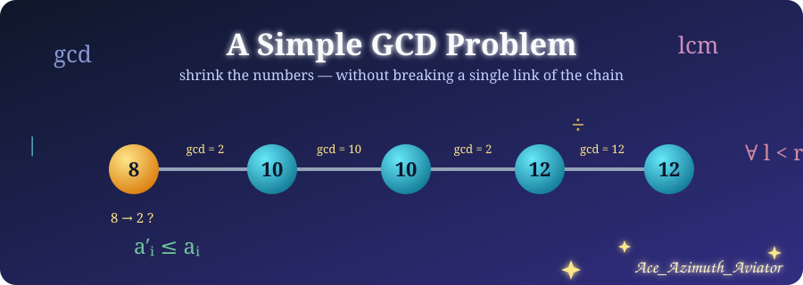
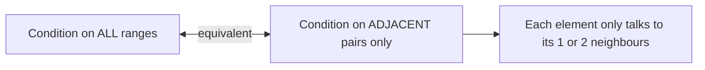
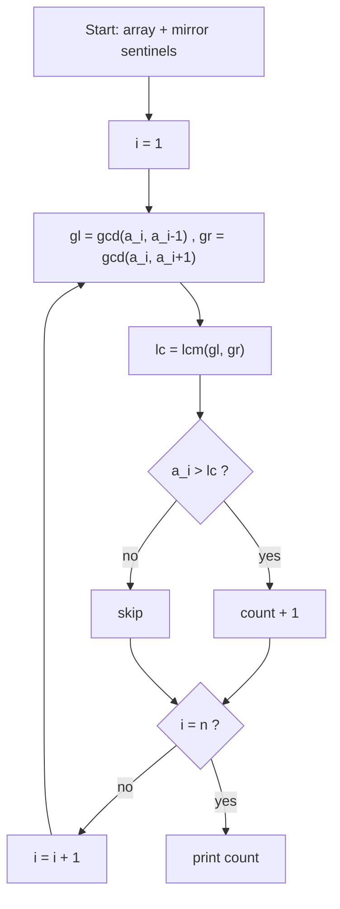
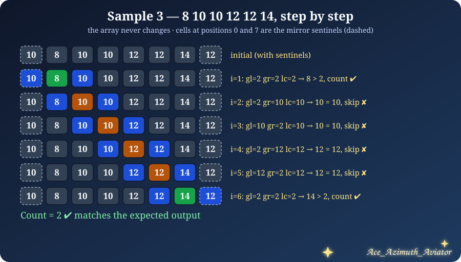
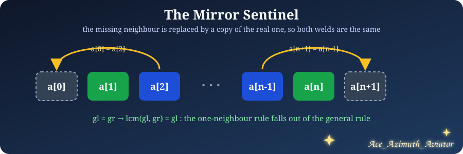

# Codeforces 2210C1 — A Simple GCD Problem (Easy Version)  

**Codeforces Round 1089 (Div. 2) · greedy, number theory · ⭐ 1200**


> **One line summary:** a condition over *every* subarray secretly collapses into a condition over *neighbouring pairs*, and for each element the smallest safe value is the **lcm of its two neighbouring gcds**.

---

## 📑 Contents

1. [The hook](#1-the-hook)
2. [The problem in plain words](#2-the-problem-in-plain-words)
3. [Thinking from scratch](#3-thinking-from-scratch)
4. [Why neighbours are enough](#4-why-neighbours-are-enough)
5. [The smallest safe value](#5-the-smallest-safe-value)
6. [The edge problem and the mirror sentinel](#6-the-edge-problem-and-the-mirror-sentinel)
7. [Can all the shrinks happen together?](#7-can-all-the-shrinks-happen-together)
8. [The algorithm](#8-the-algorithm)
9. [Simulation: sample 3, step by step](#9-simulation-sample-3-step-by-step)
10. [Code](#10-code)
11. [Complexity](#11-complexity)
12. [Judge Yourself Arena](#12-judge-yourself-arena)
13. [Reusable lessons](#13-reusable-lessons)
14. [Practice problems](#14-practice-problems)

---

## 1. The hook

Imagine a chain. Every link is a number, and every pair of neighbouring links is welded together by their **GCD**.

Someone asks: *"Can you replace some numbers with smaller ones, so that no weld, anywhere, in any stretch of the chain, ever changes?"*

At first sight the statement demands that you protect **every possible subarray**, up to about $2\cdot 10^{10}$ of them. But the chain has a secret: if you protect only the welds *between neighbours*, every longer stretch is protected for free.

That single observation is the whole problem. The rest is a tidy piece of number theory.

---

## 2. The problem in plain words

You are given an array `a` of length `n`. (The array `b` is the same as `a` in this version, so it only limits how large a new value may be: at most `a[i]` itself.)

For each index you may do **at most one** operation: replace `a[i]` with some `m` such that

- `1 ≤ m ≤ b[i]`, and since `b[i] = a[i]`,
- `m ≠ a[i]`.

So every operation **strictly decreases** an element.

After all operations, the array `a'` must satisfy:

> for every `l < r`: `gcd(a[l..r]) = gcd(a'[l..r])`

**Goal:** the maximum number of operations you can perform.

**Mini example.** `[8, 10]`: both gcds of length 2 equal `2`. Can we shrink `8` to `2`? `gcd(2, 10) = 2` ✔. Can we then also shrink `10` to `2`? `gcd(2, 2) = 2` ✔ still. So the answer for `[8, 10]` is `2`. Keep this tiny case in mind; the sentinel trick in section 6 explains why both ends behave this way.

**Problem Link:** [↗️](https://codeforces.com/contest/2210/problem/C1)

---

## 3. Thinking from scratch

Let us read the statement the way a problem solver does, one piece at a time.

**The operation is easy.** Choose an index, make it smaller. Nothing tricky.

**The condition looks scary.** "For all `l < r`" means a quadratic number of ranges. We cannot even list them for $n = 2\cdot 10^5$, let alone check them.

So the real job is to **shrink the condition** into something local. A good habit in this situation:

> When a condition talks about *all ranges*, ask: *is there a small family of ranges that already forces all the others?*

For GCD the answer is yes, and the next section proves it.

---

## 4. Why neighbours are enough

Look at one range of length 3:

$$\gcd(a_i, a_{i+1}, a_{i+2}) = \gcd\big(\gcd(a_i, a_{i+1}),\ \gcd(a_{i+1}, a_{i+2})\big)$$

The gcd of a long stretch is built from the gcds of its length-2 pieces. So:

- if **every adjacent gcd** stays unchanged, then every length-3 gcd stays unchanged,
- then by the same argument every length-4 gcd, length-5, and so on (induction).

And the other direction is trivial: adjacent pairs *are* ranges (`r = l + 1`), so they must be preserved anyway.



> **Takeaway.** The condition is equivalent to: *for every `i`, `gcd(a'[i], a'[i+1]) = gcd(a[i], a[i+1])`.*

We turned a quadratic mess into a chain where every element only cares about its neighbours.

<details>
<summary>🧠 <b>Check yourself (click to open):</b> why can a length-4 range not "break" if all adjacent gcds are fine?</summary>

Write it as $\gcd(\gcd(a_i,a_{i+1}),\gcd(a_{i+1},a_{i+2}),\gcd(a_{i+2},a_{i+3}))$. Every gcd inside is an adjacent gcd that we kept unchanged, so the result is unchanged as well. In general any range is the gcd of all its adjacent-pair gcds.

</details>

---

## 5. The smallest safe value

Now fix one element in the middle, `a[i]`, with neighbours `a[i-1]` and `a[i+1]`. Name the two welds:

- `gl = gcd(a[i], a[i-1])` — the **left** gcd,
- `gr = gcd(a[i], a[i+1])` — the **right** gcd.

We want a new value `x` for this position such that both welds survive:

$$\gcd(x, a_{i-1}) = gl \qquad \gcd(x, a_{i+1}) = gr$$

**What does `x` have to look like?**

- `gl` must divide `x` (it divides `gcd(x, a[i-1])`), and
- `gr` must divide `x`.

A number divisible by both `gl` and `gr` is divisible by their lcm. So

$$x \ \ge\ \text{lcm}(gl, gr) \qquad (\text{any valid } x \text{ is a multiple of it}).$$

**And is the lcm itself valid?** Take `x = lc = lcm(gl, gr)`.

- `lc` divides `a[i]`, because both `gl` and `gr` divide `a[i]`.
- So `gcd(lc, a[i-1])` divides `gcd(a[i], a[i-1]) = gl`, and `gl` divides both `lc` and `a[i-1]`, so it divides their gcd. Therefore `gcd(lc, a[i-1]) = gl` ✔. The right side is identical by symmetry.

> **So the smallest safe value of `a[i]` is exactly `lc = lcm(gl, gr)`, and `a[i]` can be reduced if and only if `lc < a[i]`.**

Since the operation demands `m ≠ a[i]` and `m ≤ a[i]`, the move exists exactly when `lc < a[i]`: choose `m = lc`.

I name the variables this way while solving (`gl` gcd-left, `gr` gcd-right, `lc` lcm of both, which is also the new target value of `a[i]`).

<details>
<summary>🧠 <b>Check yourself (click to open):</b> neighbours are 12 and 18, and <code>a[i] = 36</code>. What is the smallest safe value?</summary>

`gl = gcd(36,12) = 12`, `gr = gcd(36,18) = 18`, `lc = lcm(12,18) = 36`. Since `36` is not larger than `36`, this element **cannot** be reduced. Any smaller multiple of both 12 and 18 does not exist.

</details>

---

## 6. The edge problem and the mirror sentinel

The first element has only **one** neighbour and the last one too. A separate formula for them is annoying and invites bugs.

A neat way to remove the special case is to **neutralize** the missing neighbour with a copy that behaves like the existing one:

- add `a[0] = a[2]` (the left sentinel mirrors the second element),
- add `a[n+1] = a[n-1]` (the right sentinel mirrors the last-but-one element).

Now for `i = 1`: `gl = gcd(a[1], a[0]) = gcd(a[1], a[2])`, and `gr = gcd(a[1], a[2])`. They are the **same** weld, so `lcm(gl, gr) = gl` — exactly the one-neighbour rule "`a[1]` can be reduced iff `gcd(a[1],a[2]) < a[1]`". The same happens at `i = n`.

```
 index :   0    1    2    3   ...  n-1   n    n+1
 value : a[2] a[1] a[2] a[3]  ... a[n-1] a[n] a[n-1]
           ▲                                    ▲
        mirror                               mirror
```

Now **every** element runs through the **same** check, with no special cases at all. This is the same idea as the `[8, 10]` mini example: for `8`, `gl = gr = 2`, `lc = 2`, and `8 > 2`, so it shrinks.

---

## 7. Can all the shrinks happen together?

Section 5 looked at **one** element and treated its neighbours as fixed. But in the real problem the neighbours may be shrunk too. So there are two honest questions:

1. Can an index be shrunk **only if** `lc < a[i]`? (*necessary*)
2. If we shrink **every** index with `lc < a[i]` at once, is the result still valid? (*sufficient*)

Here `gl`, `gr`, `lc` are always computed from the **original** array.

**Necessary.** Take any valid final array `a'`. Its adjacent gcds equal the original ones, so `gl` and `gr` still divide `a'[i]`, hence `lc` divides `a'[i]` and `a'[i] ≥ lc`. If index `i` was really operated on, then `a'[i] < a[i]`, so `lc < a[i]`.

**Sufficient.** Build `a'` by setting `a'[i] = lc` for **every** index with `lc < a[i]`, and leaving the others alone. Look at any adjacent pair and let `g = gcd(a[i], a[i+1])` be its weld:

- `g` divides `a'[i]` and `a'[i+1]`: for an untouched element this is clear, and for a shrunk one `g` is one of the two gcds whose lcm it became. So `g` divides `gcd(a'[i], a'[i+1])`.
- `a'[i]` divides `a[i]` and `a'[i+1]` divides `a[i+1]` (`lc` divides the element it came from). So `gcd(a'[i], a'[i+1])` divides `gcd(a[i], a[i+1]) = g`.

Together: `gcd(a'[i], a'[i+1]) = g`. Every weld survives, so by section 4 the whole condition holds. ✔

> **Conclusion:** the answer is simply the number of indices where `a[i] > lcm(gl, gr)`, all computed from the original array. No order matters, and **we do not even have to modify the array**. (Writing `a[i] = lc` as we go would also give the same count, because adjacent gcds never change, but it is not needed.)

The mirror sentinels are plain copies of original values, so they obey the same argument.



<details>
<summary>🧠 <b>Check yourself (click to open):</b> in <code>[4, 6, 9]</code>, could the middle element <code>6</code> ever shrink, even if its neighbours change?</summary>

No. Its welds are `gcd(6,4) = 2` and `gcd(6,9) = 3`, so any valid new value is a multiple of `lcm(2,3) = 6`. It can never go below `6`.

</details>

---

## 8. The algorithm

1. Read `a[1..n]`.
2. Set `a[0] = a[2]` and `a[n+1] = a[n-1]`.
3. For `i = 1..n`: compute `gl`, `gr`, `lc`; if `a[i] > lc`, count it.
4. Print the count, then read (and ignore) `b`: it is a copy of `a` here, but it **must still be consumed** from the input.

I keep the test in a tiny lambda that answers one question, *"can this index be reduced?"*, and the loop simply adds its `bool` to the counter.

---

## 9. Simulation: sample 3, step by step

Array: `8 10 10 12 12 14`, so with sentinels `[10 | 8 10 10 12 12 14 | 12]`.



Notice the colours: the **green** cell is counted, the **orange** one is skipped, and the **blue** neighbours are the cells used for the welds. The numbers never change from row to row.

- `i = 1`: `8` has welds `2` and `2`, so `lc = 2` and `8 > 2`: counted.
- `i = 2`: `10` has welds `gcd(10,8) = 2` and `gcd(10,10) = 10`, so `lc = 10`: skipped.
- `i = 3`: welds `gcd(10,10) = 10` and `gcd(10,12) = 2`, so `lc = 10`: skipped.
- `i = 4, 5`: one of the welds is the element itself (`12`), so `lc = 12`: skipped.
- `i = 6`: `14` has welds `gcd(14,12) = 2` on both sides (the right side is the mirror), so `lc = 2` and `14 > 2`: counted.

Total = **2**, matching the sample.

**A second one: `2 4 8 16 32 64 128 256`.**

The welds are `2, 4, 8, 16, 32, 64, 128`. Every middle element `a[i]` has welds `a[i-1]` and `a[i]`, so `lc = a[i]` and none can shrink. Only the last one sees `gcd(256, 128) = 128` on both sides, so `256 → 128`. Answer `1` ✔.

**And `67 67 67`:** every weld is `67`, so `lc = 67`, nothing is larger, and the answer is `0` ✔.

---

## 10. Code

My accepted solution, exactly as [submitted](https://codeforces.com/contest/2210/submission/398747341):

```cpp
#include<bits/stdc++.h>
using namespace std;
main(){
    int t;
    cin>>t;
    while(t--){
        int n,p,q;
        cin>>n>>p>>q;
        vector<int>a(n+2);
        for(int i{3};i<=n;++i)cin>>a[i];
        a[0]=a[2]=q,a[1]=p,a[n+1]=a[n-1];

        auto cnt=[&](int i){return a[i]>lcm(gcd(a[i],a[i-1]),gcd(a[i],a[i+1]));};

        int mx{};
        for(int i{1};i<=n;++i)mx+=cnt(i);
        cout<<mx<<'\n';

        while(n--)cin>>p;
    }
}
```

**Reading it line by line:**

- `n,p,q` — `p` and `q` are `a[1]` and `a[2]`, read before the loop. That is why the loop for the rest starts at `i = 3`.
- `a[1]` gets `p` and the left sentinel `a[0]` and `a[2]` both get `q`.
- `a[n+1]=a[n-1]` — the right mirror sentinel.
- `cnt` — the lambda is now just a test: `true` exactly when `a[i] > lcm(gl, gr)`. It does not modify anything, and adding its `bool` to `mx` counts the index.
- `while(n--)cin>>p;` — consumes the `b` line (`n` numbers) that this version gives but never needs. `n` is not used afterwards, so counting it down is safe.
- `main(){` without `int` is accepted by GCC (it is not standard C++, but this is how the solution was submitted).

**Two small details worth noticing:**

- `lc` divides `a[i]`, so `lcm(gl, gr)` never exceeds $10^9$ and `int` is safe.
- `gcd` and `lcm` come from `<numeric>` (C++17), already included by `bits/stdc++.h`.

---

## 11. Complexity

| Part | Cost |
|---|---|
| Two gcds per element | $O(\log \max a)$ each |
| One lcm per element | one more gcd, $O(\log \max a)$ |
| Whole array | $O(n \log \max a)$ |
| Memory | $O(n)$ |

The sum of `n` is at most $2\cdot 10^5$, so this is far below the limit.

---

## 12. Judge Yourself Arena

> 🏟️ Solve each one on paper **before** opening the answer. Every case only needs the rule from section 5, `lc = lcm(gcd with left, gcd with right)`, plus the mirror sentinels. The array is never modified.

**Round 1.** `a = [6, 4]`. How many operations?

<details>
<summary>Reveal the answer</summary>

Only one weld: `gcd(6,4) = 2`. For `6`: `lc = 2 < 6` ✔. For `4`: `lc = 2 < 4` ✔.

**Answer: 2.** (The array can become `[2, 2]`, and `gcd(2,2) = 2` as before.)

</details>

**Round 2.** `a = [12, 18, 12]`. How many operations?

<details>
<summary>Reveal the answer</summary>

Welds: `gcd(12,18) = 6`, `gcd(18,12) = 6`.

- `i = 1`: `gl = gr = 6` (mirror), `lc = 6 < 12` ✔.
- `i = 2`: `gl = gcd(18,12) = 6`, `gr = gcd(18,12) = 6`, `lc = 6 < 18` ✔.
- `i = 3`: `gl = 6`, `gr = 6` (mirror), `lc = 6 < 12` ✔.

**Answer: 3.** The array can become `[6, 6, 6]`: every subarray gcd is `6`, as in the original.

</details>

**Round 3.** `a = [5, 10, 15]`. How many operations?

<details>
<summary>Reveal the answer</summary>

Welds: `gcd(5,10) = 5`, `gcd(10,15) = 5`.

- `i = 1`: `lc = 5`, `5 > 5`? No ✘.
- `i = 2`: `gl = 5`, `gr = 5`, `lc = 5 < 10` ✔.
- `i = 3`: `gl = 5`, `gr = 5` (mirror), `lc = 5 < 15` ✔.

**Answer: 2.** The array can become `[5, 5, 5]`.

</details>

**Round 4 (a trap).** `a = [4, 6, 9]`. How many operations?

<details>
<summary>Reveal the answer</summary>

Welds: `gcd(4,6) = 2`, `gcd(6,9) = 3`.

- `i = 1`: `lc = 2 < 4` ✔.
- `i = 2`: `gl = 2`, `gr = 3`, `lc = 6`, `6 > 6`? No ✘. The middle element is the **glue** between two different welds, and it cannot shrink.
- `i = 3`: `gl = 3`, `gr = 3` (mirror), `lc = 3 < 9` ✔.

**Answer: 2.** The array can become `[2, 6, 3]`: `gcd(2,6) = 2`, `gcd(6,3) = 3`, `gcd` of all `= 1`, same as the original.

</details>

---

## 13. Reusable lessons

### 🪞 Technique: The Mirror Sentinel



**Problem it solves:** an element at the border has only one neighbour, so a rule written for "left and right neighbour" needs special cases.

**The trick:** put a sentinel at each end that is a **copy of the real neighbour**. The missing side then reports the same value as the existing side, so the general formula collapses to the one-neighbour rule by itself.

**When it is safe:** the combining operation must be **idempotent**, meaning `op(x, x) = x`. For `gcd` we get `lcm(g, g) = g`, and the same works for `min`, `max`, `and`, `or`. It does **not** work for `sum` or `xor`, because counting the neighbour twice changes the result.

<details>
<summary>🧠 <b>Check yourself (click to open):</b> would a mirror sentinel work if the rule were "the sum of the two neighbours"?</summary>

No. The mirror would add the real neighbour twice, so border elements would see a different sum than the true one. A mirror needs an idempotent operation; for sums use a neutral sentinel (`0`) instead.

</details>

### Other lessons

- **"For all ranges" is a smell.** Look for a small family of ranges that implies the rest. For `gcd` (and also `and`, `or`, `min`, `max`), adjacent pairs often are that family, because those operations are associative and idempotent.
- **`lcm` is the "smallest number divisible by all constraints".** Whenever a value must be a multiple of several divisors, its minimum is their lcm.
- **Check that all decisions can be taken at once.** Every index only needs its own lower bound `lcm(gl, gr)`, and all those bounds are reached together. That is why the answer is a plain count, and why the array never has to be rebuilt.
- **Read every input line,** even those you never use. Here `b` is ignored by the logic, but multi-test input breaks if it is not consumed.

---

## 14. Practice problems

| # | Problem | Link | Idea |
|---|---|---|---|
| 1 | 2210C2 — A Simple GCD Problem (Hard Version) | [Problem Statement](https://codeforces.com/contest/2210/problem/C2) | the harder sibling; the easy-version solution does not carry over directly |
| 2 | TBA | TBA | gcd of ranges reduced to adjacent pairs |
| 3 | TBA | TBA | lcm as the minimal common multiple |

> More problems will be added when I collect good ones for this exact pattern.

---

<div align="right"><sub>✍️ <i>Ace_Azimuth_Aviator</i></sub></div>
