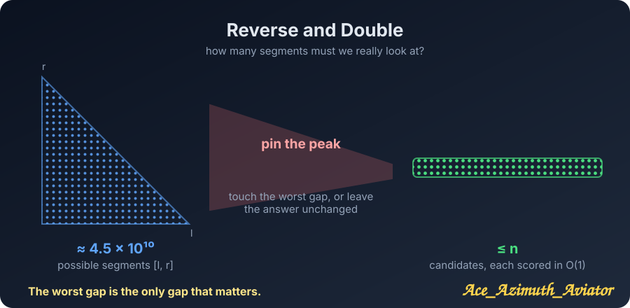
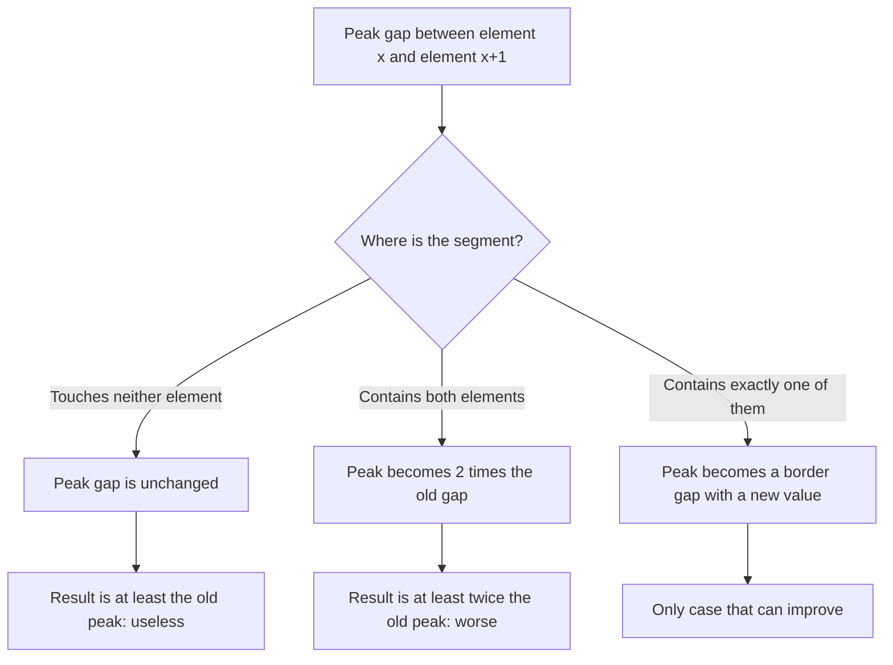
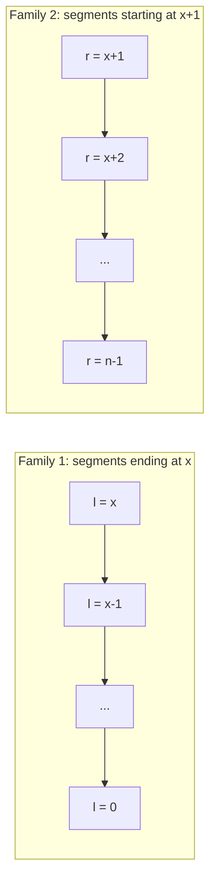
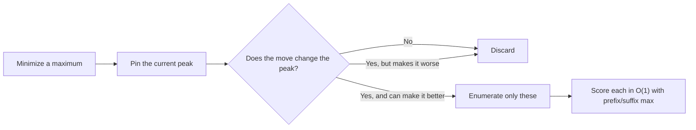

<p align="center">
  
</p>

# Codeforces 2280C — Reverse and Double

> **Upsolve** · Codeforces Round 1133 (Div. 2) · Problem C · tag: binary search · C++23  
> **Problem:** https://codeforces.com/contest/2280/problem/C  
> **Core idea:** *Pin the peak* — to lower a maximum, you must touch the maximum.  
> **Complexity:** $O(n)$ time, $O(n)$ memory

---

## Table of contents

1. [The hook](#the-hook)
2. [The problem in one minute](#the-problem-in-one-minute)
3. [What the operation really does to the gaps](#what-the-operation-really-does-to-the-gaps)
4. [The key observation: pin the peak](#the-key-observation-pin-the-peak)
5. [Which segments survive](#which-segments-survive)
6. [Evaluating a segment in O(1)](#evaluating-a-segment-in-o1)
7. [Storyboard: sample 6, frame by frame](#storyboard-sample-6-frame-by-frame)
8. [Final code](#final-code)
9. [The reusable trick: The Pinned Peak](#the-reusable-trick-the-pinned-peak)
10. [Common traps](#common-traps)
11. [Practice problems](#practice-problems)
12. [Related](#related)

---

## The hook

There are $\sim\frac{n^2}{2}$ segments you could reverse and double. With $n = 3\cdot 10^5$ that is about $4.5\cdot 10^{10}$ choices, and every one of them changes the array in a different way.

Yet the answer comes from checking only about **$n$** of them.

The reason is a single sentence:

> **The worst gap is the only gap that matters. If an operation does not rescue it, the operation is useless.**

Everything else in this article is just turning that sentence into code.

---

## The problem in one minute

You have an array $a_1, \dots, a_n$ of positive integers. You may do **at most one** operation:

- choose $l \le r$,
- **reverse** $a_l \dots a_r$,
- **double** every element of it.

The *gap value* of an array is $\max_i |a_i - a_{i+1}|$. Minimize it.

Doing nothing is allowed, so the answer is never worse than the original gap.

**Example (sample 6 in problem statement):** $a = [8,3,9,9,9,8]$ has gap value $6$ (from $3 \to 9$). Choose $l=r=2$ (1-based), i.e. double only the $3$, and you get $[8,6,9,9,9,8]$ with gap value $3$.

---

## What the operation really does to the gaps

Let $d_i = |a_i - a_{i+1}|$ be the gap between neighbours. Pick a segment $[l, r]$ (0-based in the rest of this article). After the operation the array looks like

$$
\dots,\ a_{l-1},\ \underbrace{2a_r,\ 2a_{r-1},\ \dots,\ 2a_l}_{\text{reversed and doubled}},\ a_{r+1},\ \dots
$$

So the gaps fall into exactly **three groups**:

| Group | Which gaps | New value |
|---|---|---|
| **Outside** | gaps entirely left of $l-1$ or right of $r+1$ | unchanged |
| **Inside** | gaps between two elements of the segment | $\lvert 2a_i - 2a_{i+1}\rvert = 2d_i$ (reversing does not change an absolute difference) |
| **Border** | the two gaps touching the segment | $\lvert a_{l-1} - 2a_r\rvert$ and $\lvert a_{r+1} - 2a_l\rvert$ |

<p align="center">
  
</p>

> [!NOTE]
> Reversal only moves gaps around. **Doubling** is what changes them: inside gaps become twice as large, and the two border gaps get brand-new values.

---

## The key observation: pin the peak

Let $x$ be an index where the gap is largest:

$$
d_x = \max_i d_i = a_{\text{gap}}, \qquad \text{the gap between } a_x \text{ and } a_{x+1}.
$$

Our baseline answer (no operation) is $d_x$. For an operation to be *useful*, the result must be **strictly less** than $d_x$. Look at where the peak gap ends up:



- ❌ **Segment far away:** the peak gap survives untouched, so the result is $\ge d_x$. No improvement.
- ❌ **Segment swallows both $a_x$ and $a_{x+1}$:** the peak becomes $2d_x \ge d_x$. Worse.
- ✅ **Segment contains exactly one of them:** the peak turns into a *border* gap with a new value. This is the only way to win.

> [!IMPORTANT]
> If several gaps tie for the maximum, pick any one of them as $x$. Any useful operation must fix **every** tied peak, and in particular must fix the one we pinned, so the argument still holds.

---

## Which segments survive

"Contains exactly one of $a_x, a_{x+1}$" has only two shapes:

| Shape | Segment | Free choice |
|---|---|---|
| **Ends at $x$** | $[l, x]$ | $l = x, x-1, \dots, 0$ |
| **Starts at $x+1$** | $[x+1, r]$ | $r = x+1, \dots, n-1$ |

That is at most $n$ candidates in total. The "enormous search space" collapsed to a line.



---

## Evaluating a segment in O(1)

Enumerating $O(n)$ segments is only fast if each one is scored in $O(1)$. We need three ingredients.

### 1. The outside, via prefix and suffix maxima

```cpp
vector<int> d(n - 1), p(n, 0), s(n + 1, 0);
for (int i = 0; i < n - 1; ++i)  d[i] = abs(a[i] - a[i + 1]);
for (int k = 1; k < n; ++k)      p[k] = max(p[k - 1], d[k - 1]);   // max of d[0..k-1]
for (int k = n - 2; k >= 0; --k) s[k] = max(s[k + 1], d[k]);       // max of d[k..n-2]
```

For segment $[l, r]$:

- the untouched gaps on the left are $d_0 \dots d_{l-2}$, so their maximum is `p[l-1]`;
- the untouched gaps on the right are $d_{r+1} \dots d_{n-2}$, so their maximum is `s[r+1]`.

(The gaps $d_{l-1}$ and $d_r$ are the borders, which get recomputed below.)

### 2. The inside, maintained incrementally

The inside gaps of $[l,r]$ are $d_l \dots d_{r-1}$. As the segment grows by one element, we only fold in **one** new gap:

```cpp
inner = max(inner, d[l]);   // when l moves one step left
```

The inside contributes $2 \cdot \text{inner}$.

### 3. The two borders

$$
\text{newLeft} = |a_{l-1} - 2a_r|, \qquad \text{newRight} = |a_{r+1} - 2a_l|
$$

A border only exists if the neighbour exists (`l > 0` / `r < n-1`).

### Putting it together

$$
\boxed{\ \text{res}(l,r) = \max\bigl(\,2\cdot\text{inner},\ p_{l-1},\ s_{r+1},\ |a_{l-1}-2a_r|,\ |a_{r+1}-2a_l|\,\bigr)\ }
$$

```cpp
auto calc = [&](int l, int r, int inner) {
    int res = 2 * inner;
    if (l > 0)     res = max({res, p[l - 1], abs(a[l - 1] - 2 * a[r])});
    if (r < n - 1) res = max({res, s[r + 1], abs(a[r + 1] - 2 * a[l])});
    return res;
};
```

> [!TIP]
> The five terms map one-to-one onto the table in *What the operation really does to the gaps*: inside, outside-left, outside-right, border-left, border-right. If you can name which term is which, you understand the whole solution.

---

## Storyboard: sample 6 in problem statement, frame by frame

<p align="center">
  
</p>

$a = [8,3,9,9,9,8]$ (0-based indices $0..5$)

**Frame 1 — find the peak.**

| i | 0 | 1 | 2 | 3 | 4 |
|---|---|---|---|---|---|
| $d_i$ | 5 | **6** | 0 | 0 | 1 |

$x = 1$ (the gap $3 \leftrightarrow 9$). Baseline `ans = 6`. Prefix and suffix maxima:

| k | 0 | 1 | 2 | 3 | 4 | 5 |
|---|---|---|---|---|---|---|
| $p_k$ | 0 | 5 | 6 | 6 | 6 | 6 |
| $s_k$ | 6 | 6 | 1 | 1 | 1 | 0 |

**Frame 2 — Family 1, segments ending at $x=1$.**

| Segment | inner | Array after operation | Score |
|---|---|---|---|
| $[1,1]$ | 0 | $[8,\mathbf{6},9,9,9,8]$ | **3** |
| $[0,1]$ | 5 | $[\mathbf{6},\mathbf{16},9,9,9,8]$ | 10 |

For $[1,1]$: $\max(0,\ p_0=0,\ |8-6|=2,\ s_2=1,\ |9-6|=3) = 3$. So `ans = min(6, 3) = 3`.

**Frame 3 — Family 2, segments starting at $x+1=2$.**

Every candidate has to double a $9$ next to the $3$, which creates a gap of at least $|3 - 18| = 15$ on the left border. None of them beats $3$.

**Answer: 3** ✅

---

## Final code

```cpp
#include <bits/stdc++.h>
using namespace std;

int main() {
    int t;
    cin >> t;
    while (t--) {
        int n;
        cin >> n;

        vector<int> a(n);
        for (auto &v : a) cin >> v;

        // d[i]: gap between a[i] and a[i+1]
        // p[k]: max of d[0..k-1]   (prefix maximum)
        // s[k]: max of d[k..n-2]   (suffix maximum)
        vector<int> d(n - 1), p(n, 0), s(n + 1, 0);
        for (int i = 0; i < n - 1; ++i)  d[i] = abs(a[i] - a[i + 1]);
        for (int k = 1; k < n; ++k)      p[k] = max(p[k - 1], d[k - 1]);
        for (int k = n - 2; k >= 0; --k) s[k] = max(s[k + 1], d[k]);

        // gap value after reversing and doubling [l, r];
        // inner = max original gap strictly inside the segment
        auto calc = [&](int l, int r, int inner) {
            int res = 2 * inner;
            if (l > 0)     res = max({res, p[l - 1], abs(a[l - 1] - 2 * a[r])});
            if (r < n - 1) res = max({res, s[r + 1], abs(a[r + 1] - 2 * a[l])});
            return res;
        };

        int x     = max_element(d.begin(), d.end()) - d.begin();  // pinned peak
        int ans   = d[x];                                       // no operation
        int inner = 0;

        // Family 1: segments [l, x]
        for (int l = x; l >= 0; --l) {
            if (l < x) inner = max(inner, d[l]);
            ans = min(ans, calc(l, x, inner));
        }

        // Family 2: segments [x+1, r]
        inner = 0;
        for (int r = x + 1; r < n; ++r) {
            if (r > x + 1) inner = max(inner, d[r - 1]);
            ans = min(ans, calc(x + 1, r, inner));
        }

        cout << ans << '\n';
    }
}
```

**Why the numbers are safe:** $a_i \le 10^6$, so $2a_i \le 2\cdot10^6$ and every difference fits comfortably in `int`.

**Complexity:** building $d, p, s$ is $O(n)$, the two loops are $O(n)$ in total, and every `calc` call is $O(1)$. With $\sum n \le 3\cdot 10^5$ this runs in about 0.3 s.

> [!NOTE]
> The problem is tagged *binary search* (one natural route is to binary search the answer and check feasibility). The pinned-peak argument removes the need for it: once the candidates are only $O(n)$, we can simply score all of them and take the minimum.

---

## The reusable trick: The Pinned Peak

> **Pin the Peak.** When the goal is to minimize a *maximum* over many local quantities, find the current argmax and **demand that your operation touches it**. Everything that leaves the peak alone cannot improve the answer, so it can be thrown away before you enumerate anything.

The pattern has three moves:

| Move | What you do | Here |
|---|---|---|
| **1. Pin** | Locate the current bottleneck | $x = \arg\max d_i$ |
| **2. Classify** | Split operations by how they touch the pin: *miss*, *swallow*, *graze* | far away / both inside / exactly one inside |
| **3. Enumerate the graze** | Only the "graze" family can help; enumerate it with prefix/suffix maxima and a running maximum | two $O(n)$ loops |



Two small helpers hide inside this trick and are worth remembering on their own:

- **Outside-the-window maximum:** prefix max + suffix max give "the max of everything except the window" in $O(1)$.
- **Growing-window maximum:** when a window extends by one element, update its maximum with a single `max`. Never recompute it.

Whenever a problem says *"at most one operation"* and *"minimize the maximum"*, ask first: **what happens to the current worst element?**

---

## Common traps

❌ **Forgetting the "do nothing" option.** Starting `ans` at a large value can miss the case where every operation makes things worse (sample 2 in problem statement: answer stays $1$).

```cpp
int ans = INT_MAX;   // wrong: if all operations are worse, we print a bad value
```

✅ Start from the baseline:

```cpp
int ans = d[x];      // no operation
```

---

❌ **Treating inside gaps as unchanged.** Reversing keeps $|a_i - a_{i+1}|$, but doubling doubles it. The inside contributes $2\cdot\text{inner}$, not $\text{inner}$.

✅ `int res = 2 * inner;`

---

❌ **Forgetting the new border gaps.** The outside maximum alone is not enough; the elements next to the segment now face $2a_r$ and $2a_l$.

✅ Always include `abs(a[l-1] - 2*a[r])` and `abs(a[r+1] - 2*a[l])`, each guarded by whether that neighbour exists.

---

❌ **Off-by-one in the prefix and suffix arrays.** `p[k]` covers $d_0 \dots d_{k-1}$ and `s[k]` covers $d_k \dots d_{n-2}$. For the window $[l, r]$ the outside terms are `p[l-1]` and `s[r+1]`, because $d_{l-1}$ and $d_r$ are the borders.

---

## Practice problems

| Problem | Idea to practice | Status |
|---|---|---|
| Codeforces 2280C — Reverse and Double | Pin the peak, prefix/suffix max | ✅ Solved |
| TBA | Minimize a maximum with one operation | TBA |
| TBA | Prefix/suffix maxima to score a removed window | TBA |
| TBA | Running window maximum while extending a segment | TBA |

---

## Related

- Prefix and suffix maximum arrays — *link TBA*
- Minimize-the-maximum / binary search on the answer — *link TBA*
- Difference array of adjacent absolute gaps — *link TBA*
