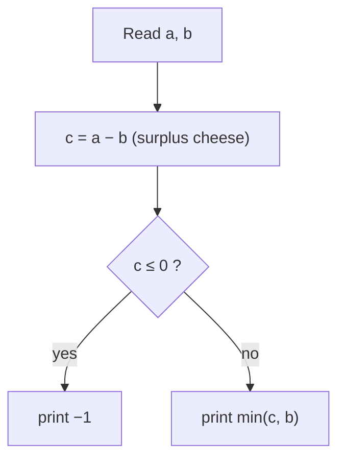

# 🥪 2276A — Perfect Sandwiches

> **Educational Codeforces Round 195 (Div. 2)  
> Problem A  
> Tag: greedy, math, \*800**  
> **One-line answer:** f(a, b) = min(a − b, b) if a > b, otherwise −1  
> **Problem:** https://codeforces.com/contest/2276/problem/A  
> **Solution:** https://codeforces.com/contest/2276/submission/397285022 



---

## 1. The problem in plain words

You have `a` cheese slices and `b` sausage slices. Use **all** of them to make sandwiches.

| Rule | Meaning |
|------|---------|
| every sandwich has ≥ 1 cheese **and** ≥ 1 sausage | no empty or one-sided sandwich |
| every slice goes on exactly one sandwich | no leftovers |
| in **each** sandwich: cheese **>** sausage | strictly greater, per sandwich |

Print the maximum number of sandwiches, or `-1` if it is impossible. `1 ≤ a, b ≤ 100`.

---

## 2. ⚠️ Remind: what the statement does **not** say

> [!WARNING]
> **There is no rule that every sandwich is identical.** Nowhere does it say "equal cheese in each sandwich" or "equal sausage in each sandwich". It is very easy to silently invent that rule, and every wrong approach to this problem does exactly that.

Read the statement as a list of **constraints**, and add nothing:

* `cheese_i > sausage_i` for every sandwich `i`
* `sausage_i ≥ 1` (which also forces `cheese_i ≥ 2`)
* `Σ cheese_i = a` and `Σ sausage_i = b`

---

## 3. The key idea: count the *surplus*

"Strictly greater" means at least **one more**. So write every sandwich as

```
cheese_i = sausage_i + extra_i        with  extra_i ≥ 1
```

Add this up over `k` sandwiches:

```
a = Σ cheese_i = Σ sausage_i + Σ extra_i = b + Σ extra_i
```

So the total **surplus** is a fixed number that no arrangement can change:

```
c = a − b = Σ extra_i
```

If `c ≤ 0` there is no surplus at all, so not even one sandwich can have more cheese than sausage. The answer is `−1`.

---

## 4. Why the answer is `min(a − b, b)`

Every sandwich must "pay" two things:

| It needs | From which pile | Pile size |
|----------|-----------------|-----------|
| at least **1 sausage** | sausage pile | `b` |
| at least **1 extra cheese** (the "+1" that beats the sausage) | surplus pile | `a − b` |

Think of making a **pair of gloves**: you need one left *and* one right, so the number of complete pairs is limited by the **smaller** pile. Here, one sandwich = one sausage + one surplus cheese, so

```
k ≤ b          (not enough sausage to give each sandwich one)
k ≤ a − b      (not enough surplus to give each sandwich its "+1")
⟹  k ≤ min(a − b, b)
```

| Case | Which pile runs out first? | Answer |
|------|----------------------------|--------|
| `a − b ≥ b` (lots of cheese) | **sausage** | `b`: one sausage per sandwich |
| `0 < a − b < b` (cheese is tight) | **surplus** | `a − b`: some sandwiches must share sausages |
| `a − b ≤ 0` | surplus is empty | `−1` |



Since `b ≥ 1` always, `min(c, b) > 0` exactly when `c > 0`, so the `−1` test and the formula agree.

---

## 5. Why *one* extra cheese per sandwich gives the maximum

This is the heart of the greedy. Look at what a sandwich really costs.

> [!IMPORTANT]
> A sandwich with `s` sausage slices needs at least `s + 1` cheese. The sausage part is paid by the sausage pile no matter how you group it. The only thing that grows with the **number of sandwiches** is the **"+1"**.

So with `k` sandwiches, the cheapest possible total is

```
cheese needed = (all sausage) + (one "+1" per sandwich) = b + k
```

and it must fit: `b + k ≤ a`, which is exactly `k ≤ a − b`.

**Exchange argument.** Suppose some sandwich gets `+2` or `+3` extra cheese. Take away everything above `+1` and use it to start or help another sandwich. No sandwich loses its "strictly greater", and we have gained a sandwich. So the best plan gives **exactly `+1` to each sandwich** and uses the remaining surplus nowhere special.

**Construction (it is reachable).** Let `k = min(a − b, b)` and `k ≥ 1`.

1. Split the `b` sausage slices into `k` non-empty groups (possible because `k ≤ b`). If `k = b`, each sausage is alone. If `k < b`, some groups share sausages. That costs no extra cheese.
2. Give group `i` exactly `sausage_i + 1` cheese. This uses `b + k ≤ a` cheese.
3. Put the leftover `a − b − k ≥ 0` cheese on **any** sandwich. More cheese never breaks "cheese > sausage".

And `k + 1` is impossible, because it would break one of the two limits.

---

## 6. The answer as a function

Math form:

```
          ⎧ min(a − b, b)    if a − b > 0
f(a, b) = ⎨
          ⎩ −1               otherwise
```

Standard C++ form:

```cpp
int f(int a, int b) {
    int diff = a - b;                 // surplus cheese
    return diff > 0 ? min(diff, b) : -1;
}
```

---

## 7. Worked examples

| `a` | `b` | surplus `a−b` | `f(a,b)` | one valid arrangement |
|----:|----:|--------------:|---------:|-----------------------|
| 6 | 4 | 2 | **2** | (3 cheese, 2 sausage) × 2 |
| 5 | 1 | 4 | **1** | (5, 1) |
| 4 | 5 | −1 | **−1** | cheese can't beat sausage |
| 3 | 2 | 1 | **1** | (3, 2) |
| 5 | 2 | 3 | **2** | (2, 1) and (3, 1): **unequal cheese!** |
| 10 | 3 | 7 | **3** | (3,1), (3,1), (4,1) |
| 10 | 7 | 3 | **3** | sausage 3+2+2, cheese 4+3+3 |
| 100 | 99 | 1 | **1** | (100, 99) |
| 100 | 100 | 0 | **−1** | no surplus at all |

> [!IMPORTANT]
> Row `5 2` is the classic trap. Two sandwiches need cheese `(2, 3)`. Five is odd, so "equal cheese per sandwich" is impossible, yet the true answer is `2`.

---

## 8. Lessons: why the tempting approaches are wrong

| ❌ Tempting idea | Why it fails | ✅ Habit to keep |
|---|---|---|
| "Cheese must be at least **2 ×** sausage" | The statement says only `>`. For `6 4` this idea claims 3 sandwiches, but the truth is 2. | Turn each rule into an inequality **exactly as written**. |
| "All sandwiches are identical, so `k` must divide `a` and `b`" | The statement never says *equal*. `5 2` breaks it. | Before coding, list what the statement **does not** promise. |
| Enumerate divisors of `b` with `i*i ≤ b` | Only half of the divisor pairs get checked, and divisors were the wrong model anyway. | If you really need divisors, test both `i` and `b / i`. |
| Patch the code after each wrong verdict | Each patch fixes one test and breaks another. | After the 2nd failure, stop patching. Hand-simulate tiny cases like `(5,2)` and `(3,2)`. |

> [!TIP]
> **Sum trick.** When every group must beat something by at least 1, write `value = base + extra, extra ≥ 1` and sum. The total becomes one equation and the bounds appear by themselves.

> [!TIP]
> **Two-limit answers.** If each unit needs "at least one of X" **and** "at least one of Y", the maximum count is `min(X, Y)`, provided the leftovers can be dumped anywhere. Here X is sausage and Y is surplus cheese.

---

## 9. Final code  
> AC Submission: https://codeforces.com/contest/2276/submission/397285022

```cpp
#include<bits/stdc++.h>
using namespace std;
main(){
    int t;
    cin>>t;
    while(t--){
        int a,b;
        cin>>a>>b;

        int c{min(a-b,b)};
        cout<<(c>0?c:-1)<<endl;
    }
}
```

**Complexity:** `O(1)` per test, `O(t)` total.

---

## 10. Try it yourself (answers hidden)

| `a` | `b` | your answer |
|----:|----:|:-----------:|
| 7 | 3 | <details><summary>show</summary><b>3</b></details> |
| 7 | 5 | <details><summary>show</summary><b>2</b></details> |
| 2 | 1 | <details><summary>show</summary><b>1</b></details> |
| 8 | 8 | <details><summary>show</summary><b>−1</b></details> |
| 20 | 6 | <details><summary>show</summary><b>6</b></details> |

---

## 11. Practice problems

**Self-made variants** (same technique: rewrite as `base + extra`, then count budgets):

| # | Change to the rules | Check value | Formula |
|--:|---------------------|-------------|---------|
| 1 | cheese **≥** sausage (not strict) | `a=4, b=4` → ? | <details><summary>show</summary><code>b</code> if <code>a ≥ b</code>, else <code>−1</code> (answer 4)</details> |
| 2 | cheese **≥ 2 ×** sausage in every sandwich | `a=9, b=4` → ? | <details><summary>show</summary><code>b</code> if <code>a ≥ 2b</code>, else <code>−1</code> (answer 4)</details> |
| 3 | cheese must exceed sausage by **at least 2** | `a=9, b=4` → ? | <details><summary>show</summary><code>min((a−b)/2, b)</code> if that is ≥ 1, else <code>−1</code> (answer 2)</details> |

**Problems from Codeforces / other judges:**

| Problem | Rating | Core idea | Status |
|---------|-------:|-----------|--------|
| Perfect Sandwiches | ~800 | min(a − b, b) if a > b, otherwise −1 | [ Educational Codeforces Round 195 (Rated for Div. 2) A](https://codeforces.com/problemset/problem/2276/A) |

*(Will be listed when I see similar problems.)*

---

## 12. Conclusion

* The problem is **not** about splitting evenly. It is about two budgets: **sausage** (`b`) and **surplus cheese** (`a − b`).
* Every sandwich needs one sausage and exactly one extra cheese to win, so the count is the **smaller** budget: `min(a − b, b)`.
* If there is no surplus, the answer is `−1`.
* The real trap is **adding a rule the statement never gave**. List the constraints literally, then solve exactly those.
* Related link(s): [Hidden Assumptions](https://github.com/Mojahidul21/My-Competitive-Programming-Journey/blob/main/Miscellaneous/CP%20Vocabulary/Programming%20%26%20Problem-Solving%20Vocabulary.md#hidden-assumptions)
