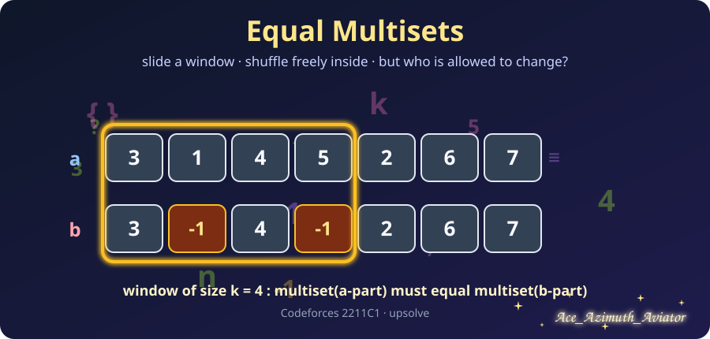
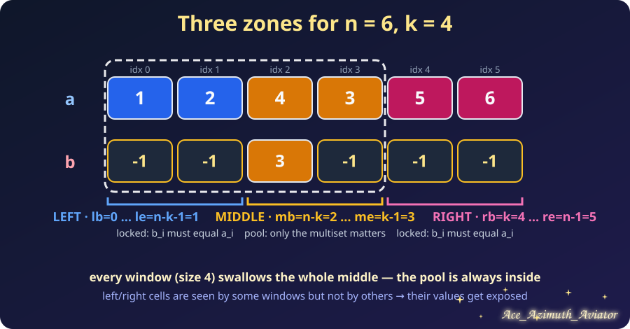
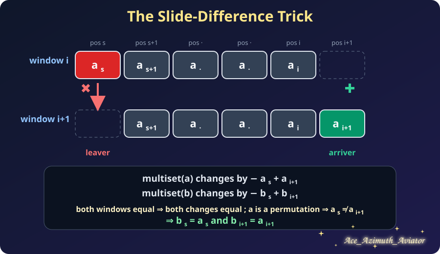

# 🪟 Cf 2211C1 — Equal Multisets (Easy Version)

| | |
|---|---|
| **Problem** | [Codeforces 2211C1 — Equal Multisets (Easy Version)](https://codeforces.com/problemset/problem/2211/C1) |
| **Contest** | Nebius Round 2 (Codeforces Round 1088, Div. 1 + Div. 2) |
| **Rating / tags** | `*1300` `binary search` `brute force` `greedy` `two pointers` |
| **Real core** | Observation + zone split (no binary search or two pointers needed in the easy version) |
| **Complexity** | O(n) per test, O(n) memory (93 ms max on the judge) |
| **Solution** | [AC submission](https://codeforces.com/contest/2211/submission/398874477) |

> **Reusable ideas born in this problem**
> 1. 🔬 **Slide-Difference Trick** — to compare *all* sliding windows, compare two *consecutive* windows: only one element leaves and one arrives.
> 2. 🔒 **Lock-and-Pool Zones** — split positions into *locked* (value must match exactly) and *pool* (only the multiset matters).
> 3. 🧮 **Consume-and-Mark** — match fixed values against a pool with wildcards (`-1`) using a single `present` array.

---

## 1. The problem in plain words

You get a permutation `a` of length `n`, a window size `k`, and an array `b` whose cells are either a value `1…n` or `-1` (a blank).

Fill every blank in `b` with any value from `1…n`. After filling, **every** window of length `k` must contain the same *bag of numbers* in `a` and in `b` (order inside the window doesn't matter, but counts do).

Can it be done?

Example (sample 3): `n=6, k=4`

```
a = 1  2  4  3  5  6
b = -1 -1 3  -1 -1 -1
```

Windows of length 4 start at positions 1, 2, 3. Fill `b = 1 2 3 4 5 6` and every window of `b` has the same bag as the matching window of `a` → **YES**.

---

## 2. How to think: start by simulating, not by theorizing

Think simple and observe the problem to find any common scenario that reflects the result or procedure to result. It needs a *pattern*, and patterns appear when you **shrink the input and look**.

### Step 1 — Simulate tiny cases by hand

Take `n = 6` and try several `k`. For each, ask one question: *"which cells of `b` am I forced to keep equal to `a`, and which cells can I shuffle?"*

Doing this on paper for a few `(n, k)` pairs reveals the same picture again and again:

> Every array falls into **three consecutive segments**: **left**, **middle**, **right**.

### Step 2 — Name the three segments


| Segment | What `b` must satisfy | Style of condition |
|---|---|---|
| **Left** | `b[i] == a[i]` for every non-blank `b[i]` | 🔒 **strict** (position-by-position) |
| **Right** | `b[i] == a[i]` for every non-blank `b[i]` | 🔒 **strict** (position-by-position) |
| **Middle** | the *values* of `b` must be a re-arrangement of the *values* of `a` | 🧺 **flexible** (as a whole) |

Segment names: `lok`, `rok`, `mok` — "left ok", "right ok", "middle ok". The answer is YES exactly when all three are true.

### Step 3 — Find the boundaries (from the simulations)

Write the beginning (`b`) and end (`e`) indices of each segment (0-indexed):

| Segment | begin | end |
|---|---|---|
| left | `lb = 0` | `le = n-k-1` |
| middle | `mb = n-k` | `me = k-1` |
| right | `rb = k` | `re = n-1` |

**Where do these numbers come from?** Slide the window from the very first position to the very last. It moves exactly `n-k` times.

- The **first `n-k` cells** are *leavers*: each one gets kicked out of the window at some point.
- The **last `n-k` cells** are *arrivers*: each one steps into the window at some point.
- Cells that are neither stay inside **every** window: that is the middle, indices `n-k … k-1`.



Look at the picture above: as `k` grows, the pool grows too, and its size is `2k - n` (when that is positive). For small `k` there is **no pool at all** — every cell is locked.

<details>
<summary>🧩 Mini-check #1 — find the pool (click after you try)</summary>

For `n = 7` and `k = 5`, what are `mb` and `me`, and how big is the pool?

<details>
<summary>Reveal answer</summary>

`mb = n-k = 2`, `me = k-1 = 4` → indices `2, 3, 4`, size `3 = 2·5 − 7`. ✅
The left is `0…1`, the right is `5…6`.
</details>
</details>

### Step 4 — Check left and right (easy part)

Walk through each locked segment. If you meet a non-blank `b[i]` with `b[i] != a[i]`, the answer is NO; blanks (`-1`) are free, because we can always fill them with `a[i]`.

### Step 5 — Check the middle (the interesting part)

In the middle we only need: **the fixed values of `b` fit inside the values of `a`, each used at most once.** Blanks are wildcards that will absorb whatever is left.

Here the trick used is a boolean array `present`:

1. For every `a[i]` in the middle, mark `present[a[i]] = true` ("this value is available").
2. For every `b[i]` in the middle:
   - `-1` → skip (a blank never causes trouble).
   - otherwise, if `present[b[i]]` is true → **consume** it (`present[b[i]] = false`).
   - otherwise → the value either isn't in the middle of `a`, or it was already used → NO.



> 💡 You never have to actually *replace* the `-1`s. The problem says "can we fill the blanks?" — but a blank can always take any leftover value. Because the pool and the middle of `b` have the **same length**, once the fixed values fit inside the pool, the number of blanks automatically equals the number of leftover values. So we only check "do the fixed values fit?" and never construct the filling.

<details>
<summary>🧩 Mini-check #2 — why can we ignore the blanks?</summary>

Pool size is `m`. The middle of `b` also has `m` cells, `f` of them fixed and `m − f` blank. Suppose the `f` fixed values are distinct and all come from the pool.

How many pool values are left, and how many blanks need them?

<details>
<summary>Reveal answer</summary>

`m − f` values left, `m − f` blanks. They match one-to-one, so any assignment works. ✅
</details>
</details>

---

## 3. The code

Accepted solution, exactly as submitted (only explanatory comments added):

```cpp
#include<bits/stdc++.h>
using namespace std;
int main(){
    ios::sync_with_stdio(false);
    cin.tie(nullptr);

    int t;
    cin>>t;
    while(t--){
        int n,k;
        cin>>n>>k;

        vector<int>a(n),b(n);
        for(auto&ai:a)cin>>ai;
        for(auto&bi:b)cin>>bi;

        bool lok{true},rok{true},mok{true};
        int lb{},le{n-k-1},rb{k},re{n-1},mb{n-k},me{k-1};

        // left zone: locked
        for(int i{lb};i<=le;++i){
            if(b[i]>0&&b[i]!=a[i]){
                lok=false;
                break;
            }
        }

        // right zone: locked
        for(int i{rb};i<=re;++i){
            if(b[i]>0&&b[i]!=a[i]){
                rok=false;
                break;
            }
        }

        // middle zone: pool, consume-and-mark
        vector<bool>present(n+1,false);
        for(int i{mb};i<=me;++i)present[a[i]]=true;

        for(int i{mb};i<=me;++i){
            if(b[i]>0){
                if(present[b[i]])present[b[i]]=false;
                else{
                    mok=false;
                    break;
                }
            }
        }

        cout<<(lok&&rok&&mok?"yes":"no")<<'\n';
    }

    return 0;
}
```

**Edge cases the zones handle for free**

| Situation | What happens |
|---|---|
| `k = n` | left `0…-1` and right `n…n-1` are empty loops; the whole array is the pool |
| `2k ≤ n` | middle range is empty (`mb > me`), left and right cover everything, so *every* cell is locked |
| `n = 1` | `k = 1 = n`, so the single cell is the whole pool: it passes unless `b[0]` is a value other than `a[0]` |

<details>
<summary>🧪 Want to stress-test it yourself? (tiny brute force)</summary>

For `n ≤ 6`, try every possible filling of the blanks and check all windows by sorting. Compare against the solution on thousands of random tests — this is exactly how to trust an observation you found by simulation.
> ⚠️ This brute force is **only a checking tool for tiny inputs** (about `n ≤ 6`). It tries every possible filling of the `-1`s, so it is far too slow for real test cases (large `n`, or many `-1`s) and would get Time Limit Exceeded if submitted. Use it on your own machine to compare against the real solution, never as a submission.

```cpp
#include<bits/stdc++.h>
using namespace std;
int main(){
    ios::sync_with_stdio(false);
    cin.tie(nullptr);

    int t;
    cin>>t;
    while(t--){
        int n,k;
        cin>>n>>k;
        vector<int>a(n),b(n);
        for(auto&ai:a)cin>>ai;
        for(auto&bi:b)cin>>bi;

        bool lok{true},rok{true},mok{true};
        int lb{},le{n-k-1},rb{k},re{n-1},mb{n-k},me{k-1};

        for(int i{lb};i<=le;++i){
            if(b[i]>0&&b[i]!=a[i]){
                lok=false;
                break;
            }
        }

        for(int i{rb};i<=re;++i){
            if(b[i]>0&&b[i]!=a[i]){
                rok=false;
                break;
            }
        }

        vector<bool>present(n+1,false);
        for(int i{mb};i<=me;++i)present[a[i]]=true;

        for(int i{mb};i<=me;++i){
            if(b[i]>0){
                if(present[b[i]])present[b[i]]=false;
                else{
                    mok=false;
                    break;
                }
            }
        }

        cout<<(lok&&rok&&mok?"yes":"no")<<'\n';
    }

    return 0;
}

---
</details>

## 4. 🏟️ Judge Yourself Arena

Solve each case **on paper first**, then open the folded answer. Cases are ordered from warm-up to boss.

Each case gives `n k`, then `a`, then `b`.

### 🟢 Case 1 — Warm-up
```
5 3
3 1 4 5 2
3 -1 4 -1 2
```
<details><summary>Your answer?</summary>

**YES.** Left = idx `0…1`, right = idx `3…4`, pool = idx `2`. `b[0]=3=a[0]` ✓, `b[4]=2=a[4]` ✓, and the pool has `b[2]=4` which is `a[2]` ✓. Blanks are free.
</details>

### 🟡 Case 2 — A value that exists, but in the wrong place
```
5 3
3 1 4 5 2
3 1 2 5 2
```
<details><summary>Your answer?</summary>

**NO.** The pool is only idx `2` (value `4`). `b[2] = 2`, and `2` isn't in the pool. Yes, `2` appears in `a` — but at idx `4`, which is a **locked** cell. Locked values can't migrate to the pool.
</details>

### 🟡 Case 3 — No pool at all
```
6 2
2 6 1 4 3 5
-1 6 1 4 5 3
```
<details><summary>Your answer?</summary>

**NO.** `2k − n = −2 < 0`, so there is no pool: every cell is locked. `b[4]=5 ≠ a[4]=3`. It looks like "the last two cells are just swapped", but windows of size 2 expose it: `{4,3}` vs `{4,5}`.
</details>

### 🔴 Case 4 — Big pool
```
7 6
5 3 7 1 6 2 4
5 2 -1 3 7 6 4
```
<details><summary>Your answer?</summary>

**YES.** Locked: idx `0` and idx `6`: `5=5` ✓, `4=4` ✓. Pool: idx `1…5` with values `{3,7,1,6,2}`. Fixed values in `b`: `2, 3, 7, 6` — distinct and all inside the pool. The blank takes the leftover `1`. Filled `b = 5 2 1 3 7 6 4` ✓.
</details>

### 🔴 Case 5 — Duplicate in the pool
```
4 3
2 4 1 3
2 4 4 3
```
<details><summary>Your answer?</summary>

**NO.** Locked: idx `0` and idx `3` pass. Pool: idx `1…2` = `{4,1}`. `b[1]=4` consumes `4`; `b[2]=4` finds `present[4]=false` → fail. The pool contains `4` only once.
</details>

---

## 5. Why it is correct - the proof



Take two neighbouring windows ending at `i` and `i+1`, with start `s = i-k+1`.

- Going from window `i` to window `i+1`, array `a` loses `a[s]` and gains `a[i+1]`.
- Array `b` loses `b[s]` and gains `b[i+1]`.
- Both windows are equal as bags, so the *change* must be identical: `−a[s] + a[i+1]  =  −b[s] + b[i+1]`.
- Since `a` is a **permutation**, `a[s] ≠ a[i+1]`, so the change is a genuine swap of two different values. The only way `b` can produce the same swap is `b[s] = a[s]` and `b[i+1] = a[i+1]`.

Every leaver (first `n-k` positions) and every arriver (last `n-k` positions) therefore gets **locked**. The leftover cells sit inside every window, so for them only the *bag* matters — and bags of locked cells already agree, so the middle bags must agree too.

**Sufficiency:** if left and right equal `a` and the middle bag of `b` equals the middle bag of `a`, each window of `b` = (same locked cells) + (same pool bag) as the window of `a`. ✅

---

## 6. 📦 Reusable knowledge

### 🔬 Slide-Difference Trick
*"All windows are equal" ⇔ "one window is equal, and every step changes both sides in the same way".*
Instead of checking `n-k+1` windows of size `k` (that is `O(nk)`), look at **what leaves and what arrives** between neighbours. Works for sums, counts, multisets, XOR… anything you can add and remove.

### 🔑 Distinctness turns "same bag" into "same value"
If you know a leaving value and an arriving value are different, *and* the other side must make the same change, the other side has no freedom. A permutation guarantee is often a hint that some positions will be **forced**.

### 🔒 Lock-and-Pool Zones
Ask of every position: *"is it ever exposed alone?"*
- Exposed alone (some window sees it while a neighbour window doesn't) → **locked**.
- Always seen together with everyone else → **pool**: only the collection matters.

Zone sizes in terms of `n, k`: locked `n-k` on each side, pool `max(0, 2k-n)`.

### 🧮 Consume-and-Mark with wildcards
To test *"fixed values ⊆ pool, each at most once"* with blanks:
1. mark the pool,
2. for each fixed value, require it to be marked, then **unmark** it,
3. skip blanks.

Counts balance themselves because both sides have the same length.

### 🧠 Habit: derive boundaries as counts, not by trial and error
Sliding `n-k` times → `n-k` leavers + `n-k` arrivers. Deriving the index formulas from a *count* means no off-by-one hunting; verify with `n = k` and `2k ≤ n` before submitting.

### ⚡ Fast input is part of the solution
With up to 2·10⁵ numbers per file, the two lines `ios::sync_with_stdio(false); cin.tie(nullptr);` and printing with `'\n'` instead of `endl` matter: the same logic dropped from about 450 ms to under 100 ms. Make it a reflex for every problem with large input.

### ⚙️ Per-test allocation should scale with `n`
The `present` array is created *inside* the test loop as `vector<bool> present(n+1,false)`. Sizing it by `n` (values in `a` are at most `n`) keeps the total work proportional to the sum of `n`. A fixed-size array such as `present(200001)` would be re-zeroed for each of up to 10⁴ tests, and `t × max(n)` is not bounded by the input guarantee.

---

## 7. 🎯 Practice problems

| Problem | Why it fits | Link |
|---|---|---|
| 2211C2 — Equal Multisets (Hard Version) | Same statement, but `a` is no longer a permutation. Re-examine the step "a[s] ≠ a[i+1] forces equality" | [Open](https://codeforces.com/problemset/problem/2211/C2) |
| TBA | Sliding windows compared through leaver/arriver | — |
| TBA | Locked vs. pool positions | — |
| TBA | Wildcard (`-1`) matching with a `present` array | — |

---

<p align="right"><i>Ace_Azimuth_Aviator</i></p>
