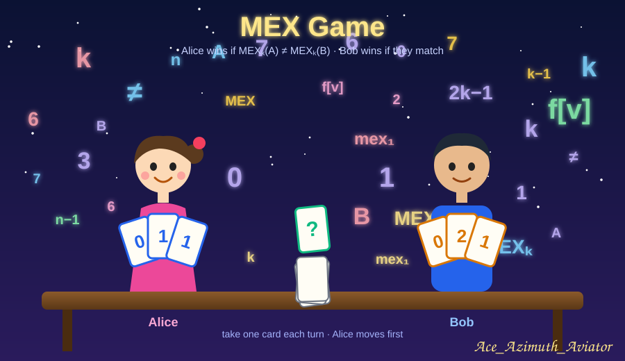
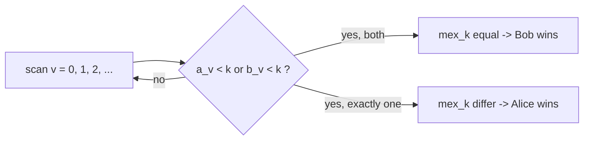
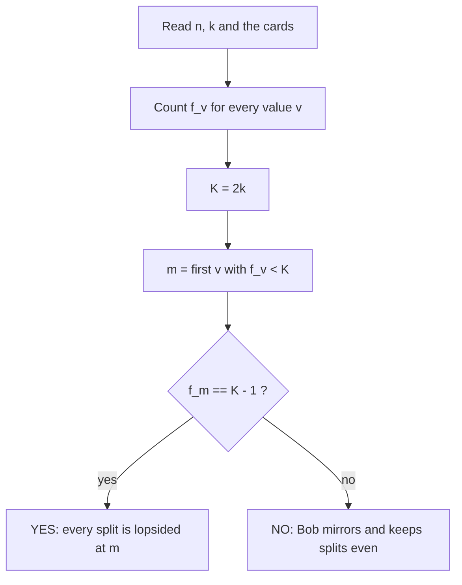
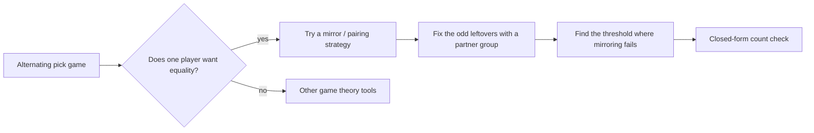

# 🃏 CF 2271B — MEX Game

> **A game with two players, a hundred thousand cards, and no decisions that actually matter.**
> The trick is to stop asking *"what should Alice play?"* and start asking *"can Bob always keep the two hands balanced?"*

---

## 📌 Metadata

| Field | Value |
|---|---|
| **Problem** | [2271B — MEX Game](https://codeforces.com/problemset/problem/2271/B) |
| **Contest** | DeepInfra Round 1 (Codeforces Round 1126, Div. 1 + Div. 2) |
| **Tag / Rating** | `games` `*1000` |
| **Limits** | 1.5 s, 256 MB |
| **Core idea** | Threshold `2k` on value frequencies + mirror (pairing) strategy |
| **Complexity** | `O(n)` time, `O(n)` memory |
| **Language** | C++23 |
| **Status** | ✅ Solved (AC) |

---

## 📖 Table of Contents

1. [The Problem in One Minute](#the-problem-in-one-minute)
2. [Warm-up: What Does mex_k Really Look At?](#warm-up-what-does-mex_k-really-look-at)
3. [Observation 1 — A Rich Value Can Never Make Both Hands Stop](#observation-1--a-rich-value-can-never-make-both-hands-stop)
4. [Observation 2 — The 2k − 1 Value Decides Everything](#observation-2--the-2k--1-value-decides-everything)
5. [Observation 3 — Otherwise Bob Mirrors](#observation-3--otherwise-bob-mirrors)
6. [The Final Rule](#the-final-rule)
7. [Walkthrough](#walkthrough)
8. [Flowchart](#flowchart)
9. [Code](#code)
10. [Common Traps](#common-traps)
11. [Reusable Trick: The Game That Isn't a Game](#reusable-trick-the-game-that-isnt-a-game)
12. [Practice Problems](#practice-problems)
13. [Related](#related)

---

## The Problem in One Minute

- You have `n` cards (`n` is even), card `i` shows `a_i`.
- Alice and Bob alternate taking **any** remaining card, Alice first. Each ends with `n/2` cards.
- `mex_k(S)` = the smallest non-negative integer that appears in `S` **fewer than `k` times**.
- **Alice wins** if `mex_k(A) ≠ mex_k(B)`; otherwise **Bob wins**.

Output whether Alice wins under optimal play.

> 💡 **Callout — Reading the goal backwards**
> Alice does not want to *make* something big. She wants the two hands to **disagree**. Bob wants them to **agree**. Whenever a game is "make them different vs. make them equal", think about **symmetry**: the player who wants equality usually has a copy-cat strategy.

---

## Warm-up: What Does mex_k Really Look At?

Let `f[v]` be how many cards show the value `v` in total. For one value `v`, the cards split as

```
a_v  +  b_v  =  f[v]        (Alice's copies + Bob's copies)
```

Scan `v = 0, 1, 2, …`. `mex_k(A)` stops at the **first** `v` with `a_v < k`. `mex_k(B)` stops at the **first** `v` with `b_v < k`.

So the two mex values are equal **exactly when** the first value where *somebody* drops below `k` is a value where *both* drop below `k`.



Everything now depends on one question: **at which value does the first drop happen, and can it be a "both" drop?**

---

## Observation 1 — A Rich Value Can Never Make Both Hands Stop

Suppose `f[v] ≥ 2k`. Can both players have fewer than `k` copies?

```
a_v ≤ k − 1  and  b_v ≤ k − 1   ⟹   f[v] = a_v + b_v ≤ 2k − 2
```

That contradicts `f[v] ≥ 2k`. So for such a value, **at most one** player can be below `k`.

> 📌 **Consequence.** If a "rich" value (`f[v] ≥ 2k`) is the place where the first drop happens, the drop is lopsided, the mex values differ, and **Alice wins**. Bob must therefore keep *both* hands at `≥ k` on every rich value, or he loses.

---

## Observation 2 — The 2k − 1 Value Decides Everything

Let `m` be the **first value with `f[m] < 2k`**. Every value before `m` is rich.

If `f[m] = 2k − 1`, look at any split:

```
a_m + b_m = 2k − 1
```

- if `a_m ≥ k`, then `b_m ≤ k − 1`
- if `a_m ≤ k − 1`, then `b_m ≥ k`

**Exactly one** player is below `k`, *always*. Combined with Observation 1 (rich values before `m` can never produce a "both" drop), the first drop is lopsided no matter how the cards are taken.

> ✅ **Alice wins automatically.** No strategy needed. The moves of the game are irrelevant.

---

## Observation 3 — Otherwise Bob Mirrors

Now suppose `f[m] ≤ 2k − 2`. Bob wants every value to split **as evenly as possible**, i.e.

```
a_v, b_v  ∈  { ⌊f[v]/2⌋ , ⌈f[v]/2⌉ }
```

Why this is enough:

- For a rich value `v < m`: `⌊f[v]/2⌋ ≥ ⌊2k/2⌋ = k`. Both hands stay `≥ k`. ✔
- For `m`: `⌈f[m]/2⌉ ≤ ⌈(2k−2)/2⌉ = k − 1`. Both hands are `< k`. ✔ (This is the first drop and it is a "both" drop.)

So the mex values are equal.

### Bob's mirror strategy

> **After Alice takes a card of value `x`:**
> 1. If another card of value `x` remains, Bob takes it.
> 2. Otherwise Bob takes a card of any value that currently has an **odd** number of remaining cards.

**Why step 2 is always possible.** Before Alice's move an even number of cards remain, so the number of values with an odd remaining count is even. In step 2 Alice just emptied value `x`, so `x` was one of those odd values; there must be at least one other.

**Why the split stays even.** Every value with an odd count has exactly one "extra" card (taken by whoever breaks the pairing), so `a_v` and `b_v` differ by at most 1. Even-count values split exactly in half.

> ⚠️ **Callout — Alice moves first, but that gives her nothing**
> Taking the first card is not an advantage here. Every card she takes is answered by a mirror card, so the first-move edge is cancelled.

---

## The Final Rule

```text
double k                      # work with K = 2k
f[v] = frequency of v
m    = smallest v with f[v] < K
answer = YES  if  f[m] == K − 1
         NO   otherwise
```

Such an `m` always exists: if `f[v] ≥ 2k` for all `v` in `0..n`, the total would be at least `(n+1)·2k > n`, impossible.

**Check against the samples** (`K = 2k`):

| Test | `k` | `K` | `f` (prefix) | `m` | `f[m]` | `K − 1` | Answer |
|---|---|---|---|---|---|---|---|
| 1 | 1 | 2 | `[2, 1, …]` | 1 | 1 | 1 | **YES** |
| 2 | 1 | 2 | `[2, 2, 0, …]` | 2 | 0 | 1 | **NO** |
| 3 | 2 | 4 | `[3, 2, 1]` | 0 | 3 | 3 | **YES** |
| 4 | 2 | 4 | `[2, 2, 2]` | 0 | 2 | 3 | **NO** |
| 5 | 2 | 4 | `[4, 3, 1]` | 1 | 3 | 3 | **YES** |

---

## Walkthrough

> A looping animation of the three cases (`k = 2`, so `2k = 4`). Cards fly from the pile to Alice (blue) and Bob (orange).



- **Part 1 (0–10 s)** — count the cards, draw the `2k` line, find `m`, the first value below it.
- **Part 2 (10–20 s)** — `f[m] = 2k − 1`: every possible split leaves exactly one hand below `k`. **YES.**
- **Part 3 (20–30 s)** — `f[m] ≤ 2k − 2`: Bob mirrors each pick, both hands stay balanced and both stop at `m`. **NO.**

---

## Flowchart



---

## Code

```cpp
#include<bits/stdc++.h>
using namespace std;

int main(){
    cin.tie(0)->sync_with_stdio(0);
    int t;cin>>t;
    while(t--){
        int n,k;cin>>n>>k;
        vector<int>f(n+1,0);
        for(int i=0,j;i<n;++i){cin>>j;++f[j];}

        bool ans=false;
        k*=2;
        if(f[0]==k-1)ans=true;
        else if(f[0]>=k){
            for(int i=0;i<n;++i)
                if(f[i]<k)break;
                else if(f[i+1]==k-1){ans=true;break;}
        }
        cout<<(ans?"YES":"NO")<<'\n';
    }
}
```

**How it reads.** The `if` handles `m = 0`. In the loop, `f[i] ≥ 2k` means value `i` is rich, so we peek at `f[i+1]`: if it equals `2k − 1` it is the first non-rich value and Alice wins. The loop stops the moment a non-rich value is reached.

---

## Common Traps

| ❌ Tempting | ✅ Correct |
|---|---|
| Treat it as a real game and search over moves | The outcome is decided by counts alone; Bob's mirror strategy or a forced split settles it |
| Compare `f[v]` with `k` | The relevant threshold is **`2k`**: it is the point where *both* hands can no longer drop below `k` |
| Look at only `f[0]` | Use the **first value** with `f < 2k`; rich values before it are skipped |
| Say "`f[m]` odd ⇒ YES" | Only **exactly `2k − 1`** forces the asymmetry; `f[m] = 2k − 3` can still be split `k−2 / k−1` (both below `k`) |
| Forget that `m` may be large | `m` can be as large as `n`; allocate `f` with room (`n + 1` or `n + 2`) |
| Rebuild counts per test with a fixed huge array | Use `vector` sized from `n` (sum of `n` is bounded, `t` up to `10^4`) |

---

## Reusable Trick: The Game That Isn't a Game

### 🪞 *The Mirror and the Ledger*

Many "players alternate taking items" problems collapse the same way:

1. **Define the final goal as a comparison of two hands** (equal vs. different).
2. **Ask whether the "equal" player has a mirror strategy.** Answer by pairing: copy the opponent's pick; when the pairing breaks (an odd leftover), take a leftover from *another* odd group. Parity of total cards guarantees such a partner exists.
3. **Find the exact threshold** where mirroring is enough, and where an unavoidable asymmetry beats it. Here that threshold is the count `2k − 1`.
4. **Reduce to a counting formula.** No DP, no simulation.



> 💡 **Callout.** A quick sanity test before coding any game: brute-force minimax on tiny inputs and compare with your formula. It takes minutes and catches a wrong threshold (`2k` vs `2k − 1` vs `k`) instantly.

---

## Practice Problems

| # | Problem | Why it fits | Status |
|---|---|---|---|
| 1 | CF 2271B — MEX Game | This article | ✅ |
| 2 | CF 2263C1 — Floor of MEX | MEX reasoning on counts | [📚 In vault](https://github.com/Mojahidul21/My-Competitive-Programming-Journey/blob/main/Upsolve/Codeforces/Codeforces%20Round%201120%20(Div.%202)/C1.%20Floor%20of%20MEX%20(Easy%20Version)/Floor%20of%20MEX%20(Easy%20Version)%20-%20CF2263C1.md) |
| 3 | TBA | Mirror / pairing strategy game | ⏳ TBA |
| 4 | TBA | "Make the two hands equal" game | ⏳ TBA |

---

## Related

- 🔗 Vault: *Floor of MEX upsolve* — [Link](https://github.com/Mojahidul21/My-Competitive-Programming-Journey/blob/main/Upsolve/Codeforces/Codeforces%20Round%201120%20(Div.%202)/C1.%20Floor%20of%20MEX%20(Easy%20Version)/Floor%20of%20MEX%20(Easy%20Version)%20-%20CF2263C1.md)
- 🔗 Vault: *Mirror / Pairing Strategy* entry — `<link TBA>`

---

<p align="right"><i>Ace_Azimuth_Aviator</i></p>
